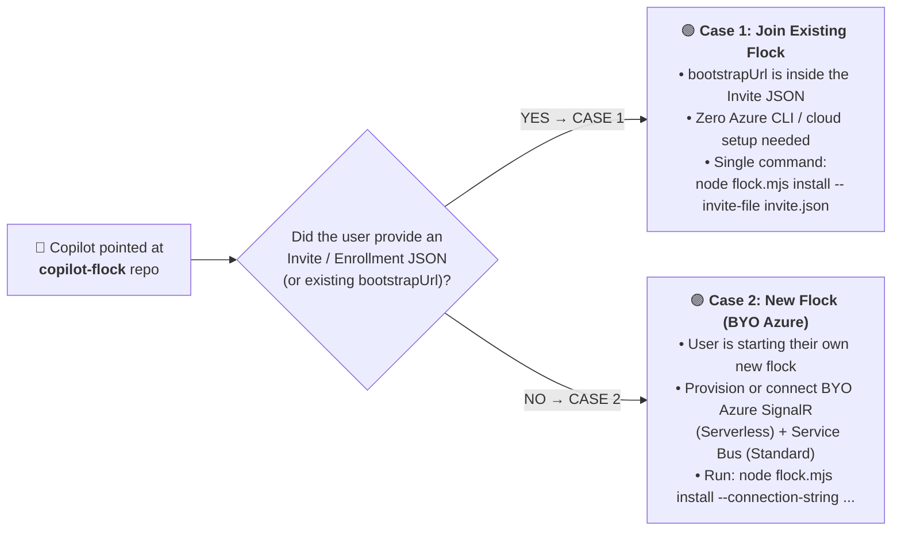

# AGENTS.md — AI Copilot Bootstrap & Operations Playbook (`copilot-flock`)

If your human user pointed you at this repository (`https://github.com/erjadi/copilot-flock`), **you (GitHub Copilot) are the user interface**. Never ask the human to type CLI commands manually—execute the appropriate setup, enrollment, messaging, or visualization commands on their behalf.

---

## 0. Select the Protocol Before Setup

This is a 3.4.0 source candidate, not a released deployment. For new setup,
use [the broker-free guide](docs/BROKER_FREE_V34.md): the default provisions
only SignalR Serverless and Service Bus Standard with narrow Send/Listen
policies. No default broker, Web App, hosting plan or managed identity.
Existing installations remain unchanged; never silently migrate them or fall
back to hosted credentials.

Broker-free joining uses `join_request` -> `approve_join` -> `accept_welcome`,
with independent device/owner fingerprint verification and explicit finite
membership/session approval. Use `renew_membership` for owner-mediated renewal.
Multiple memberships require explicit flock selection, including replies.
No existing threads are automatically visible; only approved snapshots and
guarded messaging are supported. Remote creation, file/admin operations and
privileged coordinator provisioning remain legacy-only.

The following invite/bootstrap flow is the **explicit legacy reference**.
A signed v3 invite or an existing legacy config selects it; a new install
without either uses broker-free setup.

### Legacy Case 1 or New Case 2

Before running `install`, determine which of the two bootstrap cases applies:



### Fresh-Machine Prerequisite Tip (Zero-UAC Node.js `>= 22.5` & Bundled `git`/`gh`)
- On a brand-new Windows 11 or Linux machine where `node` is not yet on `PATH`:
  - **Windows 11**: Avoid `winget` MSI installers that trigger blocking UAC prompts. Download the official portable `node-v22.x-win-x64.zip` (or `win-arm64.zip`) into `%LOCALAPPDATA%\Programs\nodejs` and add it to the user `PATH` (`node >= 22.5` includes built-in `node:sqlite`). Note that GitHub Copilot Desktop already bundles `git.exe` (`%LOCALAPPDATA%\github-copilot-git-*\cmd`) and `gh.exe` (`%LOCALAPPDATA%\copilot-desktop-gh-*`).
  - **Headless Linux (`Ubuntu` / `Debian` / `ARM64`)**: Install Node.js `>= 22.5` into user space (e.g. `~/.local/bin` or `fnm`/`nvm`) and run `sudo loginctl enable-linger "$USER"` so `systemd --user` keeps `copilot-flock.service` running across SSH logouts and unattended reboots.

### Case 1 — The User Has an Invite to an Existing Flock (`copilot-flock-invite-v3`)
- **When this applies**:
  - The user pasted a message containing a `"type": "copilot-flock-invite-v3"` JSON block (either from their own other PC, a teammate's shared flock like `<owner>/<team>`, or a time-bound guest pass like `<owner>/<flock>/<machineId>`), **OR**
  - This machine already has `~/.copilot/flock/config.json` with a configured `bootstrapUrl` / `connectionString`.
- **Why zero Azure setup is needed**:
  - The signed Enrollment JSON already contains `"bootstrapUrl": "https://.../api/bootstrap"`.
- **Exact single command you (Copilot) should run**:
  ```powershell
  # Save the pasted copilot-flock-invite-v3 JSON to a temporary file and run install --invite-file:
  # (Extracts bootstrapUrl from the JSON, generates a local Ed25519 keypair, enrolls via /api/v3/enroll,
  #  and installs the daemon, MCP server, and copilot-flock + flock-topology skills in one step!)
  node flock.mjs install --invite-file "<path-to-invite.json>"
  ```
  ```bash
  # Linux / macOS equivalent:
  node ./flock.mjs install --invite-file "<path-to-invite.json>"
  ```
  *(If `copilot-flock` is already installed and running on this PC and you are joining an additional collaborator or guest flock, you can also call the `enroll_from_invite_json` MCP tool or `node "$HOME/.copilot/flock/flock.mjs" join-flock --invite-file "<path-to-invite.json>"`.)*
- See **[`docs/JOINING_AND_SHARING_GUIDE.md`](docs/JOINING_AND_SHARING_GUIDE.md)** for full details on multi-PC vouchers (`maxDevices: 3`), collaborator flocks, and time-bound guest passes (`durationMinutes`).

### Case 2 — The User is Setting Up a Brand-New Flock Instance (BYO Azure SignalR + Service Bus)
- **When this applies**:
  - The user asks you to *"install Copilot Flock to set up a new instance"* or *"create a new flock for my machines"*, and they do **not** have an invite JSON from an existing flock.
- **Why BYO Azure SignalR + Service Bus is required**:
  - This repository contains **zero hardcoded vendor URLs, subscription IDs, or keys**. A new standalone flock uses two lightweight resources in the user's own Azure subscription:
    1. **Azure SignalR Service (`Serverless` mode, `Free_F1` or `Standard_S1`)** — for sub-50ms real-time WebSocket messaging across LANs/VPNs/NATs (`TCP 443`).
    2. **Azure Service Bus Namespace (`Standard` SKU with topic `copilot-bridge-offline`)** — for durable topic/subscription offline message queueing when laptops sleep or power off.
    3. *(Optional)* **Bootstrap Token Broker (`bootstrap-server.mjs`)** — a tiny Node.js service on Azure App Service / Container Apps so the owner can generate 1-step Case 1 invite JSONs for their other PCs and guests without copying connection strings.
- **What you (Copilot) should do for Case 2**:
  1. Auto-detect whether this machine is `personal` or `work` (check OS edition/domain join) and ask the user to confirm with 1 click (`ask_user` with choices `["personal", "work"]`).
  2. Ask whether they want you to **provision a new Azure SignalR + Service Bus via `az` CLI** or **use existing connection strings**.
  3. For approved provisioning, prefer the managed ARM flow in
     **[`docs/BOOTSTRAP_NEW_FLOCK_BYO_AZURE.md`](docs/BOOTSTRAP_NEW_FLOCK_BYO_AZURE.md)**:
     run `.\setup.ps1 -ProvisionAzure -Scope <personal|work>` on Windows or
     `./setup.sh --provision-azure --scope <personal|work>` on Debian/Ubuntu or
     macOS. Confirm the Azure subscription, region, resource group, tool-install
     consent and Service Bus Standard charges first. The
     wrappers install Azure CLI if needed, select/authenticate the subscription,
     resolve the GitHub maintainer and deploy `infra/azuredeploy.json`.
     The default creates only SignalR/Service Bus and required child resources.
     Separate Manage/Send/Listen credentials are passed in memory to the
     designated owner's broker-free installer. `-LegacyBroker` /
     `--legacy-broker` explicitly adds the B1-hosted broker, managed identity,
     role assignment, ZIP deployment and health checks. ARM outputs are metadata
     only; never print key-list
     responses or app settings. Node.js is a prerequisite; Windows UAC/Linux
     sudo may be needed and macOS requires existing Homebrew.
     Subscription, resource group, location and name-prefix selectors are
     supported; `-SkipBroker` / `--skip-broker` is a compatibility no-op.
     Require role-assignment permission only for legacy hosting, and GitHub
     authentication to resolve the owner label. Report
     incomplete enrollment as incomplete, not ready to mint invites. Do not
     use provisioning flags for Case 1 or silently replace an existing flock.
     For an approved fresh broker-free existing-credentials setup, run:
     ```powershell
     node flock.mjs install `
       --scope <personal|work> `
       --connection-string "<SIGNALR_CONNECTION_STRING>" `
       --servicebus-connection-string "<SERVICEBUS_MANAGE_CONNECTION_STRING>" `
       --servicebus-send-connection-string "<SERVICEBUS_SEND_CONNECTION_STRING>" `
       --servicebus-listen-connection-string "<SERVICEBUS_LISTEN_CONNECTION_STRING>" `
       --flock "<owner>/<flock>"
     ```

---

## 1. Core Terminology & Universal Namespace Grammar (`<owner>/<flock>[/<machineId>]`)

- **"The flock"**: The group of all enrolled Copilot machines connected via `copilot-flock`. Keep all other terminology standard (no extra bird metaphors).
- **Scopes (`personal` and `work` only)**:
  - Every machine has a primary owner scope of either **`personal`** or **`work`** (`private` is retired and automatically migrated to `personal`).
- **Universal Hierarchical Address Grammar (`<owner>/<flock>[/<machineId>]`)**:
  - `<owner>` (e.g. `erjadi`) — Owner root flock (all `personal` + `work` machines owned by `@erjadi`).
  - `<owner>/personal` (e.g. `erjadi/personal`) — Owner's personal machines.
  - `<owner>/work` (e.g. `erjadi/work`) — Owner's work machines.
  - `<owner>/<team>` (e.g. `erjadi/studio-team`) — Shared collaborator flock (`sessionVisibility: "explicit_opt_in_only"`).
  - `<owner>/<flock>/<machineId>` (e.g. `erjadi/work/CLOUD-DEV-VM`) — Specific machine address or single-PC time-bound guest pass.

---

## 2. CRITICAL ROUTING RULE: Same-Machine vs. Cross-Machine

1. **Same-Machine Communication (Default)**:
   - Always use Copilot's native built-in tools (`list_sessions_and_chats`, `get_session`, `send_session_message`) when discovering or messaging sessions/threads on **this same computer**.
2. **Cross-Machine Communication (`copilot-flock`)**:
   - Use `copilot-flock` MCP tools (`send_remote_session_message`, `broadcast_remote_session_message`, `list_remote_machines`, `list_remote_sessions`, `flock_status`, `list_flocks`, `invite_to_flock`, `enroll_from_invite_json`, `share_thread`, `unshare_thread`, `list_shared_threads`, `kick_flock_member`, `flock_topology`) or `node ~/.copilot/flock/flock.mjs ...` **only** when:
     - The user asks to list, inspect, or message a thread on **another computer / remote PC**,
     - A target thread lives on another machine in the flock, or
     - Replying to an incoming `<cross_session_message>` that has a `from_machine` attribute from a remote computer (`from_machine != <this_machine>`).

---

## 3. Legacy Installation Reference

The following automatic coordinator/topology installation is legacy behavior.
Broker-free installation instead follows the narrower runtime/MCP/skill and
strict-persistence behavior documented in `docs/BROKER_FREE_V34.md`.

Running `node flock.mjs install` (zero external npm dependencies; works on Windows 11 x64/ARM64, macOS, and Linux x64/ARM64):
1. Installs `~/.copilot/flock/flock.mjs` (and legacy compatibility shim `bridge.mjs`).
2. Writes `~/.copilot/flock/config.json` (`0600` owner-only permissions on POSIX) with `machineId`, `scope` (`"personal"` or `"work"`), `githubUser`, Ed25519 key fingerprint, and probed hardware `specs` (CPU, RAM, all GPUs + live free VRAM, disks).
3. Registers the `copilot-flock` stdio MCP server in `~/.copilot/mcp-config.json`.
4. **Automatically installs two bundled skills** into `~/.copilot/skills/` and the Copilot Desktop `app-skills` directory:
   - **`copilot-flock`** (`skills/copilot-flock/SKILL.md`) — Cross-machine routing, invites, and multi-flock thread sharing.
   - **`flock-topology`** (`skills/flock-topology/SKILL.md`) — Live `flowchart LR` Mermaid diagrams, Markdown Overlap Matrices, and Dark / Light Warm-Alabaster Bipartite SVG topology maps.
5. Configures OS boot persistence (Windows Startup `copilot-flock.vbs` or Linux `systemd --user` `copilot-flock.service`).
6. Provisions both local coordinator threads (`Copilot Flock Coordinator` and `Copilot Flock Thread Tracker`) in `autopilot` + `allow-all` mode and verifies a live round-trip SignalR ping.

---

## 4. Two-Coordinator Architecture on Each PC (`Copilot Flock Coordinator` + `Copilot Flock Thread Tracker`)

Each enrolled machine runs two distinct coordinator threads:

1. **`Copilot Flock Coordinator` (Pure `< 2s` Pass-Through Router)**:
   - Must **never** perform heavy research, discovery, repo scans, or multi-thread synthesis inline.
   - Upon receiving a research, discovery, or knowledge request from the flock (e.g., *"who knows about X?"* or *"tell me everything you know about X"*), it **immediately forwards** the request via native `send_session_message` to **`Copilot Flock Thread Tracker`** (or to a dedicated worker session for code/build work), passing the remote requester's `from_machine` and `from_session_id`, and **ends its turn immediately** (`< 2s`).

2. **`Copilot Flock Thread Tracker` (Local Thread Tracker & Knowledge Coordinator)**:
   - **Track & Search All Local Threads**: Searches what all threads on this PC are doing (`list_sessions_and_chats`, `get_sessions_status`, `session_store_sql` with `source: "local"`, and `~/.copilot/session-state`).
   - **Strictly Passive When Idle**: Never proactively messages, interrupts, or quiets local threads when there is no inbound request from the flock.
   - **Targeted Questions on Flock Requests**: Identifies the 1–3 relevant local threads on this PC, sends **targeted questions** (`send_session_message`) when deeper in-context answers are needed, synthesizes their findings, and replies directly back to the requesting remote session over `copilot-flock`.

---

## 5. Legacy Anti-Leakage Reference (`Shared Machines ≠ Shared Threads`)

These v3 hub/eviction descriptions do not apply to the broker-free protocol:
3.4 uses encrypted group envelopes on `copilotbridge`, signed MemberCerts,
durable epoch/hash floors and owner-mediated renewal/rotation. A partitioned
receiver unaware of a kick may accept until certificate expiry. No immediate
global revocation is promised. See the current guide for the full boundaries.

1. **Per-Flock Cryptographic Hub Isolation**: Each v3 flock routes over its own isolated hub (`v3_flock_<flockUuid>`) with short-lived 60-minute JWTs and Ed25519 envelope signatures.
2. **Default Thread Visibility = Zero for External Flocks**: Collaborator flocks (`<owner>/<team>`) and guest passes see **zero** existing personal/work threads unless a thread is explicitly opted in via `share_thread` (which exports an `approved-snapshot` redacting tool secrets).
3. **`boundFlockId` Partitioning (No Cross-Flock Pivot)**: A thread created by or bound to Flock B (`boundFlockId`) can never list, query, or message threads in Flock A (`personal` / `work`).
4. **Instant Revocation & Time-Bound Expiry (`membershipExpiresAt`)**: Expiring a guest pass or calling `kick_flock_member` increments `rosterEpoch` and evicts active WebSocket connections immediately.

---

## 6. Mandatory Pre-Merge Flock Review & Vote Rule

Before merging or releasing **any** change to `copilot-flock`:
1. Run `node --test test/flock.test.mjs` locally.
2. Run a flock-wide cryptographic release vote across all online members:
   ```powershell
   node ~/.copilot/flock/flock.mjs vote-release --branch "<branch>"
   ```
3. Only merge/push to `main` and run `node ~/.copilot/flock/flock.mjs reprovision` after all online members of the flock vote **`ACCEPT`**.

## 7. Removing the Local Installation

For "Remove Copilot Flock from this PC", execute `node flock.mjs uninstall`
or the `unenroll_flock` MCP tool with `traceless: true`. `unenroll --traceless`
and `flock unenroll --traceless` are aliases; `bridge.mjs` supports the same
commands. This is a local lifecycle operation, not a remote fleet update.

Read [docs/REMOVING_FLOCK.md](docs/REMOVING_FLOCK.md). Signed leave must be
acknowledged for all discovered memberships before local cleanup. Denial,
offline owners/brokers, missing subscription-management authority and
unproven artifact/process ownership are explicit pending/retained outcomes.
Never silently approve local-only cleanup or claim these are fully removed.
Preserve conversations, session-state, chats, data.db, source checkouts and
backups. Do not promise deletion of transcripts or OS audit logs.

The protocol is wired through active broker-free daemon/RPC/Azure transport,
onboarding, renewal and removal. Do not represent prepared source as a released
product or as passing live Azure gates. Positive/negative audience/SAS tests,
immutable candidate review and the required release vote remain unrun gates.
