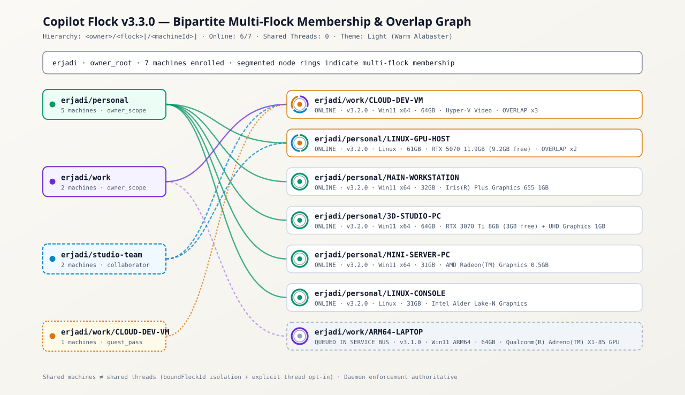
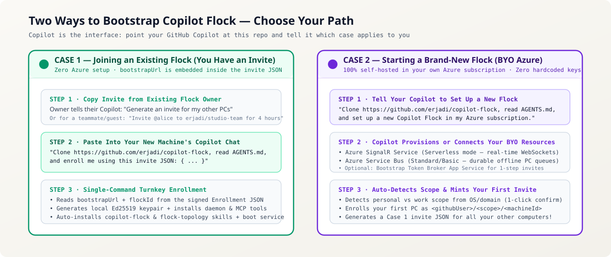
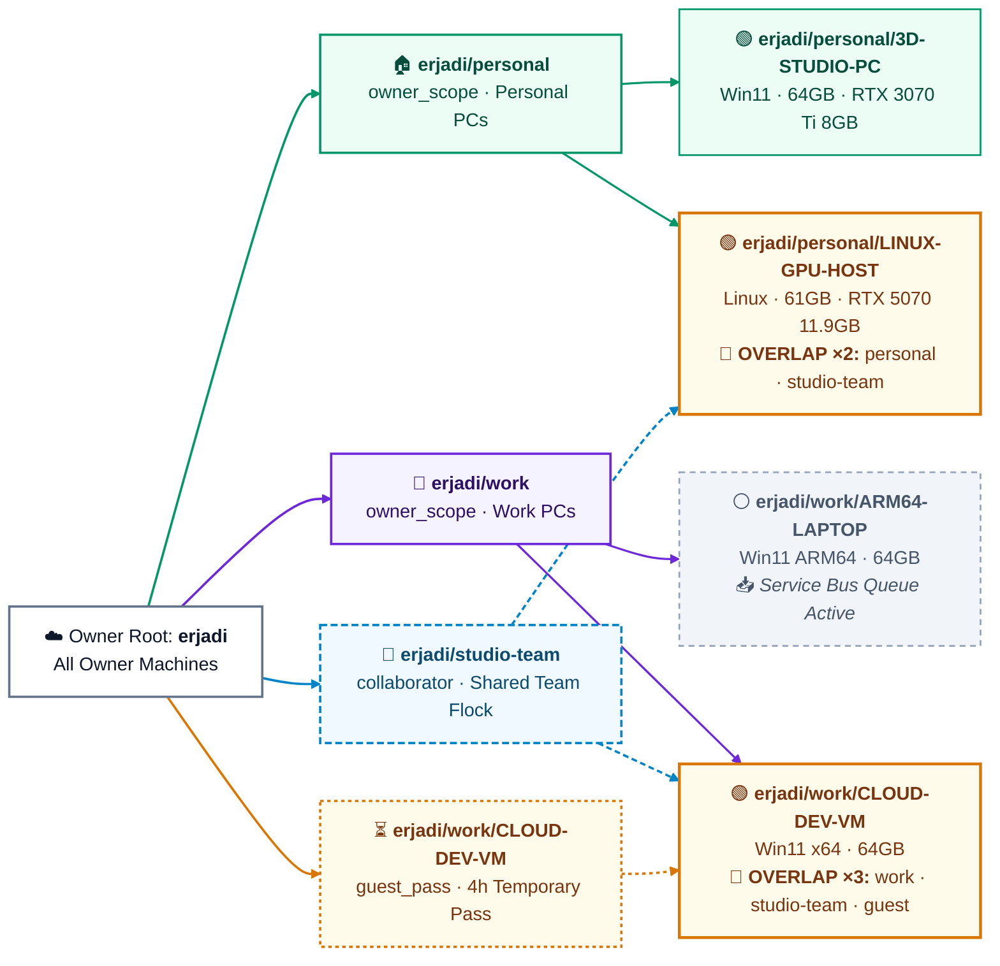
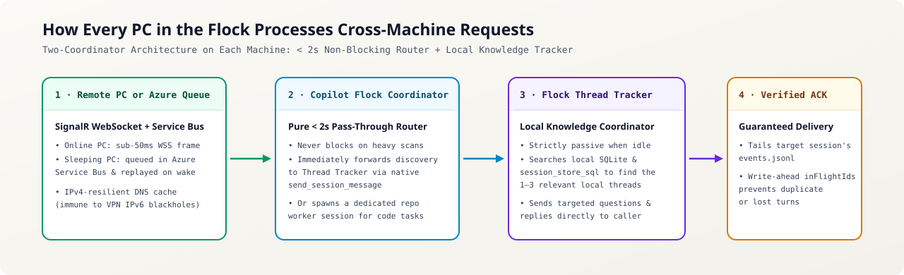
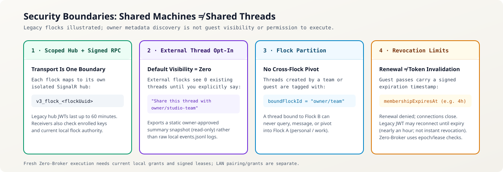

# Copilot Flock (`copilot-flock`)

Licensed under [Apache-2.0](./LICENSE). Copyright 2026 Eric Jadi.
Viewer preview data, hostnames, network addresses and governance examples are
synthetic, not captured conversations or real signed release evidence.

**3.4.0 broker-free runtime:** broker-free onboarding, scoped Azure
issuance/renewal, encrypted active RPC, owner-mediated leave/kick and guarded
uninstall are wired. New setup defaults to two Azure services, not a hosted
broker. Existing installations are untouched. A source version alone does not
establish release or deployment readiness: exact-commit positive/negative live
Azure isolation, immutable review and the all-online ACCEPT release vote are
required gates. Confirm the published tag and its evidence before upgrading. See the
[current broker-free behavior and limitations](./docs/BROKER_FREE_V34.md).

**Connect all of your GitHub Copilot computers—Windows desktops, ARM64 laptops, headless Linux GPU servers, and cloud VMs—into one real-time, peer-to-peer flock.**

Ask your laptop's Copilot what your home desktop is building, dispatch a task to your Linux RTX workstation, or give a teammate a 4-hour guest pass to inspect a shared machine—**entirely in plain English**.

For example: *"Ask my Linux GPU server's Copilot to check whether its worker is
ready for this build, and bring the answer back here."* Full deployed Flock
routes that request to the remote coordinator, hands deeper discovery to its
tracker, and returns permitted findings to the requesting session. Deploy the
stack once in your Azure subscription, then enroll additional PCs with signed
invites.

| Your Situation | Copy & Paste This Single Prompt into Your GitHub Copilot Chat |
| :--- | :--- |
| **🟢 Path 1 — Joining an Existing Flock** | `"Read AGENTS.md and create a device-bound Join Code for owner/team. Help me verify the owner's fingerprint before accepting their Welcome Ticket."` Legacy broker invites remain explicitly supported. |
| **🟣 Path 2 — Starting a Brand-New Flock** *(Setting up your own BYO Azure SignalR + Service Bus instance)* | `"Clone https://github.com/erjadi/copilot-flock, read AGENTS.md, and set up a brand-new Copilot Flock instance in my Azure subscription."` |

The viewer's local server binds to `127.0.0.1` by default. `VIEWER_HOST` is an
explicit opt-in to another bind address; this administrative viewer has no
added authentication boundary and must not be exposed to an untrusted network.

To remove the local installation, tell Copilot: *"Remove Copilot Flock from
this PC and leave all its flocks. Preserve my conversations and repositories."*
Copilot reports pending remote cleanup or retained artifacts rather than
claiming success when an owner/broker is offline or authorization is missing.
See [removal scope and limitations](./docs/REMOVING_FLOCK.md).

Upgrading an existing legacy client preserves its protocol, registered identity
and memberships; it does not migrate cloud resources or credentials to
broker-free mode. Release, canary rollout and resident-daemon versus caller-MCP
verification are distinct gates. See
[upgrade boundaries](./docs/BROKER_FREE_V34.md#release-and-existing-client-upgrades).

## Managed Azure setup: one approved Copilot-led flow

Tell Copilot: *"Set up a new full Flock using the managed ARM template. Confirm
my Azure subscription, resource group, region, scope and costs first."*
Copilot can run `.\setup.ps1 -ProvisionAzure -Scope personal` on Windows or
`./setup.sh --provision-azure --scope personal` on Debian/Ubuntu or macOS.
Selectors include subscription, resource group, location and resource-name
prefix (`-SubscriptionId`, `-ResourceGroup`, `-Location`, `-NamePrefix`, or
`--subscription`, `--resource-group`, `--location`, `--name-prefix`). Defaults
are the current subscription, `rg-copilot-flock`, `eastus` and `flock`.

The wrappers install Azure CLI if missing, authenticate if needed, deploy
[`infra/azuredeploy.json`](./infra/azuredeploy.json).
Keys are retrieved through authorized subscription/resource-pinned Azure
commands, then passed in memory to the broker-free owner installer.
Neither ARM outputs nor managed installer arguments contain keys. Windows CLI
installation can require UAC; Debian/Ubuntu can require `sudo`; macOS requires
existing Homebrew. Headless Linux uses device-code login. Node.js must already
be available. Without the provisioning flag, existing invite/direct-string
installation remains unchanged and no Azure resources are provisioned.

The template defaults to **SignalR Serverless (Free_F1) and Service Bus
Standard**, with topic `copilot-bridge-offline`, Send-only `FlockSendRule` and
Listen-only `FlockListenRule`. Service Bus is billed separately. There is no
default Web App, hosting plan, managed identity or broker deployment.
`-LegacyBroker` / `--legacy-broker` explicitly restores the legacy hosted path,
including separately billed B1 hosting and role-assignment requirements.
`-SkipBroker` / `--skip-broker` is a compatibility no-op for the new default.
Setup confirms persisted enrollment and daemon readiness before success;
this is not evidence that the required live scope-isolation gate passed.
This is your own deployment, not a vendor-hosted service. Local mock tests do
not establish live Azure acceptance; resources remain deployed on failures.
See the [managed setup guide](./docs/BOOTSTRAP_NEW_FLOCK_BYO_AZURE.md).

*(Prefer dark mode? View the [Dark-Mode Bipartite SVG Topology Map](./docs/assets/flock-topology-dark.svg) or ask your Copilot: `"Show me a flock topology diagram"`.)*

---

## Legacy compatibility feature guide

The following existing feature, onboarding and architecture reference describes
the **explicit legacy/broker-backed mode**, including one-step v3 invites,
privileged coordinators and its broader RPC surface. It is not the new
broker-free default or a promise of unconditional offline delivery, latency
or immediate global revocation. For new 3.4.0 setup, two-step joining and the
narrower active surface, use [the current guide](./docs/BROKER_FREE_V34.md)
and [managed setup](./docs/BOOTSTRAP_NEW_FLOCK_BYO_AZURE.md).

### Why Copilot Flock Exists

Most developers and engineers work across more than one machine: a **work laptop**, a **personal desktop**, a **headless Linux GPU server or robot brain**, and a **cloud VM**. Normally, each computer's GitHub Copilot is trapped on an island—it has no idea what your other computers are working on.

**Copilot Flock (`copilot-flock`) bridges those islands:**
- **Talk to Copilot, Not the Terminal**: You never need to memorize CLI flags. Just tell your Copilot *"Ask my home desktop what branch it's on"*, *"Broadcast to all RTX machines to check free VRAM"*, or *"Invite @alice to erjadi/studio-team"*.
- **Sleeping Laptop? No Problem**: Real-time messages travel over **Azure SignalR WebSockets** (`< 50ms`). If a laptop is asleep or powered off, messages wait safely in **Azure Service Bus** and drain automatically the moment it wakes up.
- **Works Everywhere (GUI + Headless Linux)**: Bridges **GitHub Copilot Desktop** (`ws.port` local control plane on Windows/macOS/Linux) and **headless GitHub Copilot CLI** (`copilot -p --session-id=<uuid> --allow-all` on Ubuntu/Debian/Jetson/SBCs).
- **100% Private BYO Cloud (Zero Hardcoded Vendor Keys)**: This repository contains zero hardcoded endpoints or credentials. You either join an existing flock with a **1-step Invite JSON** or run your own flock in your own Azure subscription for pennies.

---

## Getting Started: Which Path Are You On?

Whenever you point a new GitHub Copilot at `https://github.com/erjadi/copilot-flock`, it reads **[`AGENTS.md`](./AGENTS.md)** and automatically follows one of two paths:

### Path 1 — You Have an Invite to an Existing Flock *(30 Seconds · Zero Azure Setup)*
Use this path if:
- You are **adding your 2nd, 3rd, or 7th computer** to your own flock,
- A teammate invited you to a **shared collaborator flock** (e.g. `erjadi/studio-team`), or
- Someone gave you a **time-bound guest pass** to a machine (e.g. `erjadi/personal/LINUX-GPU-HOST` for 4 hours).

**What to do:**
Paste the invite message into your GitHub Copilot chat:
> *"Clone `https://github.com/erjadi/copilot-flock`, read `AGENTS.md`, and enroll me using this invite JSON: `<paste JSON>`"*

Because the signed `copilot-flock-invite-v3` JSON already contains the flock's `bootstrapUrl`, **you do not need an Azure account, Azure CLI, or any connection strings**. Your Copilot generates a local Ed25519 keypair, exchanges the signed voucher for a hub token, installs the background daemon + MCP tools + skills (`copilot-flock` & `flock-topology`), and connects immediately.
- Full guide: **[Joining an Existing Flock & Sharing Threads (`docs/JOINING_AND_SHARING_GUIDE.md`)](./docs/JOINING_AND_SHARING_GUIDE.md)**

---

### Path 2 — You Are Starting a Brand-New Flock Instance *(BYO Azure SignalR + Service Bus)*
Use this path if you are setting up **your own independent flock** for the very first time.

**What to do:**
Open GitHub Copilot on your first computer and say:
> *"Clone `https://github.com/erjadi/copilot-flock`, read `AGENTS.md`, and set up a brand-new Copilot Flock instance in my Azure subscription."*

Your Copilot will:
1. Auto-detect whether your computer is a **`personal`** or **`work`** machine and ask you to confirm with 1 click.
2. Provision your own **Azure SignalR Service**, **Service Bus Standard** offline topic and default **Token Broker Web App** (or connect to approved existing resources).
3. Enroll your first computer as `<your-github-handle>/<scope>/<HOSTNAME>` and generate a **Path 1 Invite JSON** that you can paste into all of your other computers!
- Full guide: **[Setting Up a Brand-New Flock with BYO Azure (`docs/BOOTSTRAP_NEW_FLOCK_BYO_AZURE.md`)](./docs/BOOTSTRAP_NEW_FLOCK_BYO_AZURE.md)**

---

## Talk to Copilot, Not the Terminal: Everyday Examples

Once enrolled, your Copilot has built-in MCP tools (`copilot-flock`) and skills (`copilot-flock`, `flock-topology`). Here is what you can say in plain English:

| What You Say to Copilot | What Happens Behind the Scenes |
| :--- | :--- |
| **"Who is online in the flock right now, and what GPUs are free?"** | Queries all enrolled machines, probing live CPU, RAM, disk, and multi-GPU free VRAM (`nvidia-smi`). |
| **"Show me a flock topology diagram in light mode."** | Invokes the bundled `flock-topology` skill (`flock.mjs topology --theme light`) to render a `flowchart LR` Mermaid graph, Markdown Overlap Matrix, and Warm-Alabaster SVG map. |
| **"Ask my home desktop (`3D-STUDIO-PC`) what its latest threads are working on."** | Routes a `<cross_session_message>` to `3D-STUDIO-PC`'s `Copilot Flock Coordinator`, which hands off in `< 2s` to `Copilot Flock Thread Tracker` and returns a synthesized summary. |
| **"Start a new thread on `LINUX-GPU-HOST` in `example/robot-stage` to run the camera calibration test."** | Calls `create_remote_session` on `LINUX-GPU-HOST` (Linux) and wakes a dedicated repo worker session. |
| **"Generate an invite so I can add my work laptop to `erjadi/work`."** | Calls `invite_to_flock` and gives you a copy-pasteable prompt + signed `copilot-flock-invite-v3` JSON (`maxDevices: 3`). |
| **"Give `@bob` a 2-hour guest pass to `erjadi/personal/LINUX-GPU-HOST`."** | Mints a time-bound voucher (`durationMinutes: 120`) scoped strictly to `LINUX-GPU-HOST`. Automatically evicts WebSockets when time expires. |
| **"Share this thread with `erjadi/studio-team`."** / **"What threads am I sharing?"** | Opts the current session into `erjadi/studio-team` via `share_thread` (`approved-snapshot` redacting raw tool secrets) or audits active shares via `list_shared_threads`. |

---

## Universal Hierarchical Addressing (`<owner>/<flock>[/<machineId>]`)

Every flock and machine uses a single, self-describing address grammar—modeled after GitHub's `owner/repo` convention:

- **Strictly Two Owner Scopes (`personal` & `work`)**: Every machine belongs to either `<owner>/personal` or `<owner>/work` (`private` is retired and automatically migrated to `personal`).
- **Owner-Level Awareness**: Because **you** own the flock and machines are participants, any `@<owner>` computer automatically discovers all flocks owned by `@<owner>` via `/api/v3/my-flocks`.

### Markdown Flock Overlap Matrix (`Machine × Flock`)
Alongside the `flowchart LR` graph and Bipartite SVG, `flock.mjs topology` outputs a compact Markdown matrix showing at a glance which machines bridge multiple flocks:

| Machine | Status | `erjadi (root)` | `personal` | `work` | `studio-team` | `guest_pass` | Non-Root Scopes |
| :--- | :--- | :---: | :---: | :---: | :---: | :---: | :--- |
| **`CLOUD-DEV-VM`** | 🟢 Online | 🔵 | — | 🟣 | 🟠 | ⏳ | **3 *(overlap ×3)*** |
| **`LINUX-GPU-HOST`** | 🟢 Online | 🔵 | 🟢 | — | 🟠 | — | **2 *(overlap ×2)*** |
| **`3D-STUDIO-PC`** | 🟢 Online | 🔵 | 🟢 | — | — | — | 1 |
| **`MAIN-WORKSTATION`** | 🟢 Online | 🔵 | 🟢 | — | — | — | 1 |
| **`MINI-SERVER-PC`** | 🟢 Online | 🔵 | 🟢 | — | — | — | 1 |
| **`LINUX-CONSOLE`** | 🟢 Online | 🔵 | 🟢 | — | — | — | 1 |
| **`ARM64-LAPTOP`** | ⚪ Offline (Queued) | 🔵 | — | 🟣 | — | — | 1 |

---

## How It Works Under the Hood: Two-Coordinator Architecture

To keep every machine responsive in `< 2 seconds`—even when running long builds or searching hundreds of local threads—`node flock.mjs install` automatically provisions two specialized background sessions on each PC:

1. **`Copilot Flock Coordinator` (Pure `< 2s` Pass-Through Router)**:
   - Acts strictly as a non-blocking switchboard.
   - When a cross-machine question arrives (e.g. *"Which thread on this PC worked on the SignalR viewer?"*), it immediately forwards the request via native `send_session_message` to **`Copilot Flock Thread Tracker`** (or spawns a dedicated repo worker session for code changes) and finishes its turn in `< 2s`.
2. **`Copilot Flock Thread Tracker` (Local Knowledge Coordinator)**:
   - Strictly passive when idle—never interrupts your local work unprompted.
   - When handed a query from the flock, it searches local SQLite session history (`~/.copilot/data.db` and `session_store_sql`), identifies the 1–3 relevant local threads, asks them targeted questions if needed, and replies directly back to the remote caller.

---

## Security & Privacy: Shared Machines ≠ Shared Threads

Sharing a GPU server or cloud VM with a teammate or guest **never** exposes your personal or work conversations on that machine. `copilot-flock` enforces **4 Anti-Leakage Hard Walls** inside the local daemon and token broker:

1. **Wall 1 — Per-Flock Cryptographic Hub Isolation (`v3_flock_<uuid>`)**: Each flock has its own isolated SignalR hub, Ed25519 envelope signatures, and short-lived 60-minute JWTs.
2. **Wall 2 — Explicit Thread Opt-In (`share_thread`)**: Collaborator flocks (`<owner>/<team>`) and guest passes have **zero visibility** into existing local threads. External members can only see a thread if you explicitly say *"Share this thread with `<owner>/<team>`"*, which exports a redacted `approved-snapshot`.
3. **Wall 3 — `boundFlockId` Partitioning (No Cross-Flock Pivot)**: Any thread created from a shared flock is permanently tagged with `boundFlockId` and blocked from listing, reading, or messaging threads in your `personal` or `work` flocks.
4. **Wall 4 — Instant Revocation & Time-Bound Guest Passes (`membershipExpiresAt`)**: Guest passes expire automatically on the minute, and saying *"Remove `@user` from `<owner>/<flock>`"* increments `rosterEpoch` and drops active WebSocket connections in real time.

---

## Documentation Map (For All User & Agent Types)

| Document | Audience | What It Covers |
| :--- | :--- | :--- |
| **[`AGENTS.md`](./AGENTS.md)** | **AI Copilots** pointed at this repository | Decision tree for **Case 1 (Invite)** vs **Case 2 (BYO Azure)**, routing rules, Two-Coordinator pattern, and pre-merge voting. |
| **[`docs/JOINING_AND_SHARING_GUIDE.md`](./docs/JOINING_AND_SHARING_GUIDE.md)** | **Humans & Teammates (Case 1)** | Joining via 1-step Invite JSON, adding your own PCs, collaborator flocks (`<owner>/<team>`), 4-hour guest passes, and thread sharing. |
| **[`docs/BOOTSTRAP_NEW_FLOCK_BYO_AZURE.md`](./docs/BOOTSTRAP_NEW_FLOCK_BYO_AZURE.md)** | **New Flock Owners & DevOps (Case 2)** | Setting up a brand-new flock instance with BYO Azure SignalR (`Serverless`) + Service Bus + optional Token Broker. |
| **[`skills/flock-topology/SKILL.md`](./skills/flock-topology/SKILL.md)** | **Bundled Topology Skill** | Auto-installed skill teaching Copilot how to render `flowchart LR` Mermaid diagrams, Overlap Matrices, and Dark/Light Bipartite SVGs. |
| **[`skills/copilot-flock/SKILL.md`](./skills/copilot-flock/SKILL.md)** | **Bundled Cross-Machine Skill** | Auto-installed skill teaching Copilot same-machine vs cross-machine routing and conversational flock management. |
| **[`docs/V3_MULTI_FLOCK_ARCHITECTURE.md`](./docs/V3_MULTI_FLOCK_ARCHITECTURE.md)** | **Security & Systems Architects** | Deep-dive specification of the `v3` cryptographic envelope, Ed25519 key hierarchy, `/api/v3/*` endpoints, and threat model. |
| **[`docs/V3_IMPLEMENTATION_AND_TEST_PLAN.md`](./docs/V3_IMPLEMENTATION_AND_TEST_PLAN.md)** | **Contributors & Reviewers** | Test suite coverage (`test/flock.test.mjs`), `--sandbox v3` isolation testing, and adversarial release voting (`vote-release`). |

---

## Fleet Console UI (`viewer/`)

`copilot-flock` also includes a full interactive React + Vite + Tailwind **Fleet Console UI** in [`viewer/`](./viewer/) (`npm run dev` or `node viewer/viewer-server.mjs`):
- **Flocks View & Header Switcher**: Inspect `<owner>`, `<owner>/personal`, `<owner>/work`, collaborator teams, and guest passes with live countdown badges.
- **Interactive Topology & Overlap Matrix (`TopologyView.tsx` & `FlockOverlap.tsx`)**: Switch between Orbital, Mesh, Bipartite Ribbon Graph, and Matrix views in both Dark and Warm-Alabaster Light themes.
- **1-Click Invite Generator, Shared Thread Audit & Instant Kick**: Generate copy-pasteable `copilot-flock-invite-v3` prompts, audit opted-in threads, and inspect 7/7 Ed25519 governance votes.

---

## Quick Troubleshooting & Platform FAQ

| Question | Answer |
| :--- | :--- |
| **What happens if I message a laptop while it is asleep or powered off?** | The message is persisted in **Azure Service Bus** (`Standard` topic `copilot-bridge-offline`) and replayed automatically with write-ahead `inFlightIds` deduplication the moment the laptop wakes up. |
| **Does it work over corporate VPNs, NordVPN, or OpenVPN?** | Yes. All traffic uses outbound `TCP 443` (`HTTPS`/`WSS`), and the built-in IPv4-first DNS resolver (`ipv4Lookup` + `dns.resolve4` fallback cache) prevents dead VPN IPv6 DNS adapters from blackholing SignalR reconnects. |
| **How does background boot persistence work on Windows vs. Headless Linux?** | On Windows, `install` registers `copilot-flock.vbs` in your Startup folder (runs at user login). On Linux, `install` enables `~/.config/systemd/user/copilot-flock.service` (run `sudo loginctl enable-linger "$USER"` once on headless servers so it runs at boot without a console login). |
| **Does giving a teammate or guest access to a machine let them read my other chats or run arbitrary commands?** | **No.** External flocks see `0` existing threads unless you explicitly run `share_thread` (which exports a static, read-only `approved-snapshot` summary). Cross-user/guest callers are restricted to informational queries within `boundFlockId`; `autopilot` + `allow-all` Coordinator/Thread Tracker execution is strictly limited to same-owner flocks. |
| **How do I check health or repair all machines in my flock?** | Just tell your Copilot: *"Diagnose and repair the flock"* (runs `diagnose_bridge_fleet` with `auto_fix: true`). |
