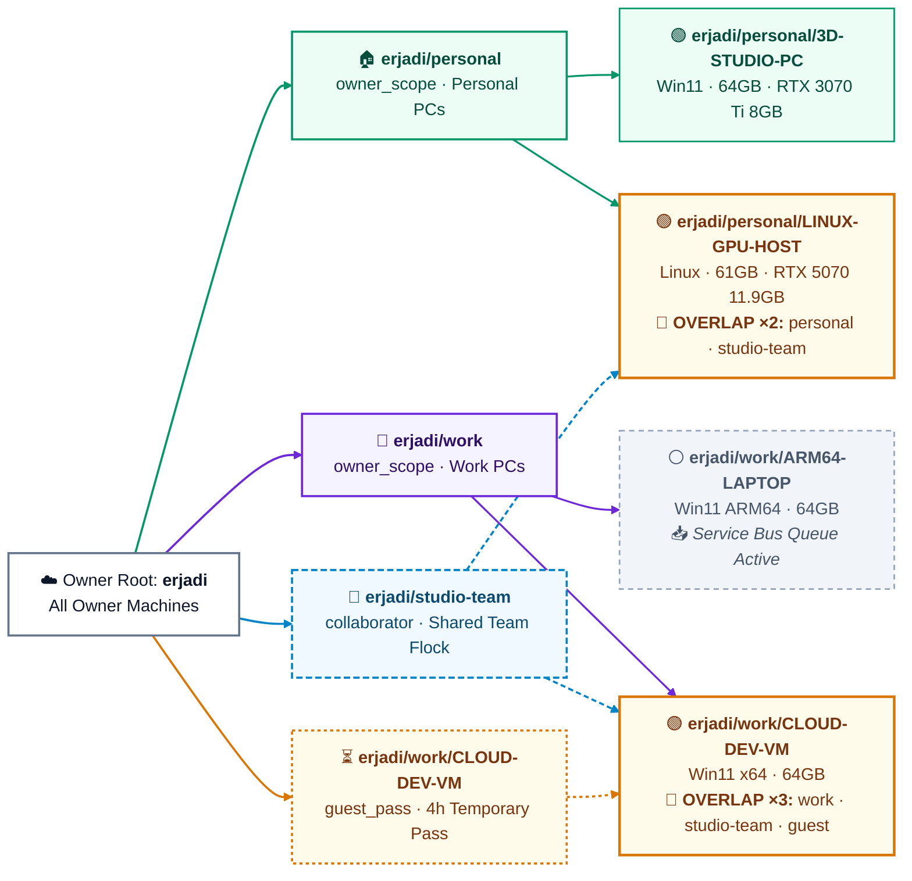

# Copilot Flock (`copilot-flock`)

Licensed under [Apache-2.0](./LICENSE). Copyright 2026 Eric Jadi.
Viewer preview data, hostnames, network addresses and governance examples are
synthetic, not captured conversations or real signed release evidence.

**Zero-Broker candidate:** this checkout wires fresh installation, scoped
enrollment, CLI/MCP operations, Pages publication and owner renewal to the
signed-roster implementation (Node.js >=22.5). Release approval and real
Azure/Pages acceptance are still required; production installations are
unchanged. Existing legacy configurations and `copilot-flock-invite-v3`
broker invites retain their original path. No silent migration is performed.

Node 22.5-22.12 (also obsolete Node 23.0-23.3) requires `--experimental-sqlite`; setup, installed MCP and
daemon/startup commands propagate it. Prefer Node 22.13+ for unflagged startup.
The npm Flock/test scripts enable SQLite explicitly; Copilot must supply the flag
for direct CLI/API execution on those older versions.
This candidate was exercised on Node 24, not every supported Node/platform pair.
Fresh provisioning rejects an existing configuration before creating Azure
resources. Re-running installation for an existing Zero-Broker identity repairs
local integration without generating new keys or reinitializing its roster.

**Coordinate enrolled Copilot computers through your own Azure resources,
with encrypted messages and explicit local authority.**

Ask Copilot to inspect permitted owner metadata, message a selected existing
Desktop session, or share an approved summary with a time-bound guest.
The Zero-Broker native profile does not expose privileged headless spawning.

For example: *"Message the existing Desktop session I granted on my other PC."*
`DELIVERED` means confirmed session admission, not completion of its task.
`UNKNOWN` is retained across crashes/timeouts and must not trigger a blind resend.

| Your Situation | Copy & Paste This Single Prompt into Your GitHub Copilot Chat |
| :--- | :--- |
| **🟢 Path 1 — Joining an Existing Flock** *(You have an Invite JSON from your other PC or a teammate)* | `"Clone https://github.com/erjadi/copilot-flock, read AGENTS.md, and enroll me using this invite JSON: <paste JSON>"` |
| **🟣 Path 2 — Starting a Brand-New Flock** *(Setting up your own BYO Azure SignalR + Service Bus instance)* | `"Clone https://github.com/erjadi/copilot-flock, read AGENTS.md, and set up a brand-new Copilot Flock instance in my Azure subscription."` |

The viewer's local server binds to `127.0.0.1` by default. `VIEWER_HOST` is an
explicit opt-in to another bind address; this administrative viewer has no
added authentication boundary and must not be exposed to an untrusted network.

Live viewer transcript/project failures are visible errors, not synthetic
working-tree or test-result substitutes. Synthetic content is preview-only;
inactive views discard late read responses. Overview refreshes reuse an
in-flight transcript read for the same API source, machine and session, so
the ten-second overview cadence does not starve slower reads.

### Retained legacy broker/RPC compatibility

Legacy broker-backed operation now requires an **independently verified HTTPS
broker-origin pin** before resolving or sending a reusable GitHub token.
Ask Copilot to confirm the issuer origin through a trusted channel, then use
`--bootstrap-origin-pin` (or `COPILOT_FLOCK_ALLOWED_BOOTSTRAP_ORIGIN`). An
invitation's URL/key, a device signature, or an old unpinned `bootstrapUrl` is
not independent issuer trust. Existing legacy configurations need explicit
origin confirmation; this does not automatically deploy or migrate anything.

Legacy RPC senders, receivers and broker must be upgraded coherently. Requests
and responses bind the receiving flock UUID/epoch, enrolled peer, recipient,
reply audience and payload. Active keys/membership come from the authenticated
broker directory, never caller-provided registries/policies or presence.
Successful responses recheck active authority, the roster epoch and current
snapshot grants before disclosure; revoked or replaced grants fail closed.
Unbound v2 packets and old queued authority are rejected rather than silently
reinterpreted. Direct credentials without trusted enrollment are not an RPC
enrollment substitute. Guest/collaborator legacy access is limited to explicit
approved static snapshots, not owner-session prompt injection. These application
checks do **not** make existing static-hub JWTs cryptographically revoked;
their documented reconnect window remains a separately accepted legacy limit.

## Managed Azure setup: one approved Copilot-led flow

Tell Copilot: *"Set up a new full Flock using the managed ARM template. Confirm
my Azure subscription, resource group, region, scope and costs first."*
Copilot selects a dedicated public roster repository and obtains publication
consent before running the wrapper. On Windows it adds `-RosterRepository
<owner>/<roster-repo> -PublishRoster` to `.\setup.ps1 -ProvisionAzure -Scope
personal`; on Debian/Ubuntu or macOS it adds `--roster-repository
<owner>/<roster-repo> --publish-roster` to `./setup.sh --provision-azure
--scope personal`.
Optional resource-group and region settings are `-ResourceGroup` / `-Location`
or `--resource-group` / `--location` (defaults: `rg-copilot-flock`, `eastus`).

The wrappers install Azure CLI if missing, authenticate if needed, deploy
[`infra/azuredeploy.json`](./infra/azuredeploy.json), and pass the resulting
issuer outputs privately over stdin into owner initialization. Windows CLI
installation can require UAC; Debian/Ubuntu can require `sudo`; macOS requires
existing Homebrew. Headless Linux uses device-code login. Node.js must already
be available. GitHub CLI authentication and repository/Pages/workflow permissions
are required for the owner. Other devices use pinned pre-bound invites or
provisional vouchers; guests receive no raw Azure keys. `-Legacy` / `--legacy`
explicitly selects the old setup. Do not provision Azure for an invite or LAN trial.

The template creates **SignalR Serverless (Free_F1 by default), Service Bus
Standard and the offline topic**. Service Bus is billed; quotas, regional
availability and subscription policy can reject deployment. It does **not**
deploy a Token Broker, and Zero-Broker does not need one. Connection-string outputs
are sensitive Azure deployment records, not publishable setup logs. This is
managed provisioning of your own components, not a vendor-hosted service.
See the [managed setup guide](./docs/BOOTSTRAP_NEW_FLOCK_BYO_AZURE.md).

### Two Azure resources and a signed public roster

The candidate uses **Azure SignalR Serverless + Azure Service Bus
Standard + a signed `github.io` roster**, with no hosted token broker.
The ARM template now also defines topic-level `FlockSendRule` (Send only)
and `FlockListenRule` (Listen only), with sensitive issuer-key/connection-string
outputs. Owner initialization configures an Actions-backed Pages repository,
archives signed history and publishes the latest roster with GitHub SHA CAS.
Each epoch stages a separate topic with exactly those two rules and
recipient-filtered subscriptions. GitHub publication is not proof that the
public Pages deployment is already visible.

**Encrypted Identities & Pseudonymous Public Metadata:** per-flock public
records contain opaque peer IDs and public keys, not member GitHub handles or
hostnames. Member transport credentials and authorized owner vaults are
recipient-sealed. RPC bodies are additionally recipient-sealed inside the
signed group envelope, so possessing the group key does not expose another
recipient's payload. Hosting-account URLs, membership counts, public-key
relationships and update timing remain observable; this is not zero metadata
leakage.

**Bounded Revocation & Automatic Epoch Cutover:** tested kick/expiry helpers
advance the signed epoch, replace the group key and isolate hubs/topics/
subscriptions. Receivers reject older verified epochs and expired signed
leases. The maximum signed lease is one hour and assumes accurate clocks. An online,
authorized issuer renews when one-third of the lease remains and polls for
expired members. Close requests are reconciled from a private persisted
cutover proposal; uncertain publication never causes blind cleanup.
Root-signed genesis checkpoints support new-device bootstrap without
unbounded history downloads. No sub-second revocation SLA is claimed.

The RPC runtime denies non-root arbitrary execution and unrestricted
transcripts. Even a genesis signer needs a current local execution/live-data
grant; a roster role does not grant OS authority. Verified private owner
metadata discovery is distinct from execution/transcript grants. Shared
flocks only permit locally approved snapshots. Desktop admission is tested
against a fake Desktop control endpoint; cloud provisioning, Pages builds
and multi-PC Zero-Broker cloud delivery have not had live acceptance.
The isolated LAN trial is unchanged.

Use Copilot to prepare a per-flock key card, independently verify both device
fingerprints, and obtain a pre-bound owner invite. Voucher recipients remain
non-executing until the owner verifies their fingerprints and publishes
one-time redemption. On the receiver, Copilot uses `grant-root --flock
<uuid> --sessions <selected-uuids>` only with local user approval; `revoke-root`
removes those live grants. `share_thread` requires an explicit bounded summary,
not an automatic transcript export. Private state lives under
`~/.copilot/flock/zero-broker/<uuid>`; never recreate a missing admission ledger
under an existing device key. `resume-init` reconciles a saved signed genesis
after ambiguous publication; incomplete Azure staging requires reconciliation
of the exact reported resource, not a new identity.

**Capacity and compatibility:** SignalR Free has limited connections and a
20,000-message/day allowance measured in outbound 2 KiB units. This transport
publishes to the epoch hub, so recipient-sealed RPC still incurs connected
recipient fan-out. Requests, receipts, reconciliation and payload size all
count; do not infer that a six-PC workload fits Free. Zero-Broker does not use
the legacy 45-second presence broadcast. Service Bus Standard operations and
GitHub Actions/Pages limits remain separate constraints. No paid SKU change
or live load acceptance is implied. The administrative viewer and legacy
topology/fleet/update tools remain legacy-only, not Zero-Broker native tools.

**Release validation:** the legacy release-review RPC validates an immutable
Git commit in an isolated, bounded worker, without blocking the daemon during
the full root suite. It checks every `.mjs`, requires the canonical/compatibility
entry points to match, and requires all seven root suites, including the
actual legacy RPC security regressions and both Zero-Broker suites.
The compatibility fast check includes its local fixture dependency and an
isolated profile; it does not replace full-candidate validation.
Version-2 Ed25519 ballots bind the full commit SHA and validation evidence.
Missing voters, selected subsets, unregistered keys and legacy smoke-only
ballots cannot approve a merge. Older ballots remain diagnostically verifiable,
not full-scope approval. LAN and viewer checks remain separate release evidence;
these changes neither upgrade live reviewers nor authorize deployment.

## Try it out hubless; deploy the components for the real potential

**The Hubless LAN-Direct Trial is a "Try It Out" onboarding sandbox, not the
full deployed product.** It lets you see two Copilots exchange a message on
the same reachable local network without first provisioning Azure components.
Ask Copilot: *"Help me try the separate hubless LAN trial on these two PCs.
Keep full Flock unchanged, and ask before pairing, granting sessions or changing
firewall rules."* See the [trial guide](./docs/LAN_TRIAL.md).

On prepared PCs the demonstration can take a few minutes; dependency setup,
certificate verification, firewalls and permission prompts can take longer.
"Sandbox" describes the limited onboarding scope, **not an OS sandbox** or
permission to trust remote prompts. The trial has its own entry point, state,
keys and `copilot-lan-trial` MCP name. It passed a bounded Windows two-PC live
acceptance run and independent code reviews, not universal live-platform tests.

**The Zero-Broker candidate uses Azure SignalR Serverless, Service Bus Standard
and signed Pages publication; it does not deploy a Token Broker.**
SignalR provides real-time cloud rendezvous; Service Bus supplies durable
offline transport. Pre-bound invites or independently approved voucher claims
enroll further PCs. The following comparison describes the existing legacy
deployment's broader capabilities, not the narrower Zero-Broker native profile.

### Legacy capability comparison: "Try It Out" vs. existing deployed Flock

| Capability | Hubless LAN-Direct Trial (`lan-trial`) | Full deployed Copilot Flock (`flock.mjs`) |
| --- | --- | --- |
| Setup | Zero cloud/Azure provisioning; separate dependency preparation and temporary listener/state on each PC. | Owner provisions/connects SignalR Serverless + Service Bus; deploys a broker for signed invites. |
| Network reach | Explicit private IPv4 and port on the same reachable LAN; both listeners must run. | Outbound cloud connections avoid peer inbound ports/NAT forwarding; intended across home, office, coffee shops and hotspots. |
| Firewall friction | Per-host access must be checked; a narrowly scoped inbound rule and Windows UAC consent may be needed. No automatic firewall changes. | No inbound application listener required in the deployed design. SignalR uses WSS over TCP 443; Service Bus uses the deployed client's configured transport. Corporate proxy/egress policies still apply. |
| Offline delivery | None. Sleeping, unreachable or non-listening peers cannot receive; results may be `OFFLINE` or `UNKNOWN`. | Service Bus store-and-forward drains on reconnect/wake with deduplication, subject to queue configuration, retention and credentials. |
| Pairing/enrollment | Exchange public certificate offers, independently verify fingerprints and approve both peers locally. | Signed `copilot-flock-invite-v3` enrolls additional machines in one Copilot-led step through the deployed broker. "30 seconds" is an ideal onboarding target, not a guarantee. |
| Finding useful sessions | Manually select session UUIDs and grant each peer/session/action; no automatic spawning. | Two coordinators route requests and search/synthesize permitted local knowledge; router aims to hand off in under two seconds, not finish research in that time. |
| GUI/headless fleet | Existing Desktop loopback control plane only; no headless CLI fallback. | Desktop machines plus headless Ubuntu/Debian/GPU CLI hosts, subject to platform setup and runtime availability. |
| Permissions | Selected existing sessions keep their modes/tool permissions; no CLI privilege substitution. | Broader orchestration includes privileged coordinator/headless flows. Review their trust and permissions separately; do not infer the trial's narrow guarantees. |
| Namespaces/sharing | Local pinned peers with default-zero session grants; no cloud multi-flock hierarchy. | `<owner>/<flock>[/<machineId>]`, `personal`/`work`, collaborator teams and time-bound guests, with four anti-leakage boundaries. |
| Remote sessions | Excluded. | Remote session creation and worker routing. |
| Files/Git | Excluded; no arbitrary file/branch RPC. | SHA-256 chunked files and Git-bundle transfer. |
| Coordination/resources | No distributed locks or fleet governance. | Resource locks, live machine/multi-GPU VRAM telemetry and signed Ed25519 release voting. |
| Visualization | Minimal peer status and explicit session list. | Mermaid/overlap views and bipartite SVG flock topology maps. |
| Revocation | Local peer/session revoke; cannot undo admitted work. | Per-flock membership revocation and time-bound guest expiry, with their documented isolation rules. |

### Why the trial hits a wall in daily engineering

Our live onboarding exposed the cost of a cloudless direct connection: choose
the right interface/port, inspect per-PC Windows firewall policy, handle UAC
consent where needed, exchange and verify certificate offers, and explicitly
share a particular session UUID with message permission. Copilot performs the
commands, but cannot eliminate those local security decisions. A listener,
network or certificate change means revisiting that setup.

Leave the LAN or lose reachability through VLANs, Wi-Fi client isolation or a
VPN, and that direct endpoint stops being useful. VPNs are not universally
incompatible, but the trial provides no traversal or route repair. A sleeping
laptop has no queue waiting for it. A headless Linux CLI server cannot use this
Desktop-only adapter. There is no fleet switchboard, guest invitation lifecycle,
session spawning, file transfer or release ballot in the trial.

For everyday work, ask: *"Deploy full Copilot Flock's components in my Azure
subscription, then enroll these machines with signed invites."* That is a
separate installation decision, not an automatic upgrade of trial state.
The [new-deployment guide](./docs/BOOTSTRAP_NEW_FLOCK_BYO_AZURE.md) and
[joining guide](./docs/JOINING_AND_SHARING_GUIDE.md) cover those paths. External
collaborators still see **no sessions by default**: the full platform's
switchboard does not bypass explicit sharing or flock boundaries.

### Deployment costs, security and versioned evidence

Azure SignalR offers a Free tier usable with Serverless mode, subject to its
connection/message limits. Service Bus **Standard** supplies the required
topics/subscriptions; broker hosting on the legacy path is separate. Budget for their
published capacity/usage charges and monitoring rather than assuming the
whole deployment is free or promising a fixed price. Small deployments can
use low-cost hosting, but actual cost depends on region, traffic and sizing.

The four full-platform security boundaries are: isolated per-flock
`v3_flock_<uuid>` cryptographic hubs; explicit `share_thread` opt-in with
approved snapshots; `boundFlockId` partitioning; and membership expiry /
`rosterEpoch` revocation. Same-owner autopilot/allow-all sessions may execute
trusted owner instructions. External/guest callers are restricted to permitted
informational access; sharing a machine does not authorize privileged execution
or expose all of its sessions.

| Version/platform evidence | What was established | What was not established |
| --- | --- | --- |
| Full Flock v3.3 baseline | Desktop Windows x64/ARM64 and Linux x64 GUI/headless CLI are full-runtime deployment paths; 7 baseline tests passed locally and in independent Linux review. | Seven tests are not exhaustive platform certification, a latency promise or seven release votes. |
| LAN trial r5, Windows x64 | 46/46 isolated tests; real two-PC Windows11 Desktop admission both ways, denied unshared/post-unshare access and restored original state. | Not every Windows/Desktop build, network policy or future app version. |
| LAN trial r5, Windows ARM64 | Independent 46/46 isolated tests and code-only review. | No physical ARM64 Desktop acceptance in this trial. |
| LAN trial r5, Ubuntu x64 | Independent 46/46 isolated tests plus 7/7 full baseline. | No live Linux Desktop trial acceptance; trial cannot use headless CLI. |
| macOS/other architectures | Full setup includes platform paths; no new live evidence from this trial. | No new certification or all-platform guarantee. |

The LAN trial always needs Desktop's `ws.port`/`ws.token` control plane.
The full platform's headless CLI path is deliberately separate; never use its
privileged fallback to make a trial acceptance test appear to pass.

*(Prefer dark mode? View the [Dark-Mode Bipartite SVG Topology Map](./docs/assets/flock-topology-dark.svg) or ask your Copilot: `"Show me a flock topology diagram"`.)*

---

## Legacy platform reference

The remaining architecture, coordinator, topology, viewer, file-transfer and
headless examples document the existing legacy deployment. Fresh Zero-Broker
setup uses the native profile above, not these privileged legacy capabilities.
Direct legacy installation must explicitly select `--architecture legacy`
(`-Legacy` / `--legacy` in setup wrappers). Existing legacy configurations
and signed v3 broker invites retain their original behavior. Trusted legacy
`owner_root` / `owner_scope` discovery does not require external sharing;
collaborator/guest session access remains explicit, even for same-owner identities.
The viewer now handles repo-less chats and unknown timestamps and its build
requires TypeScript checking.

## Why Copilot Flock Exists

Most developers and engineers work across more than one machine: a **work laptop**, a **personal desktop**, a **headless Linux GPU server or robot brain**, and a **cloud VM**. Normally, each computer's GitHub Copilot is trapped on an island—it has no idea what your other computers are working on.

**Copilot Flock (`copilot-flock`) bridges those islands:**
- **Talk to Copilot, Not the Terminal**: You never need to memorize CLI flags. Just tell your Copilot *"Ask my home desktop what branch it's on"*, *"Broadcast to all RTX machines to check free VRAM"*, or *"Invite @alice to erjadi/studio-team"*.
- **Sleeping Laptop? No Problem**: Real-time messages travel over **Azure SignalR WebSockets** (`< 50ms`). If a laptop is asleep or powered off, messages wait safely in **Azure Service Bus** and drain automatically the moment it wakes up.
- **Works Everywhere (GUI + Headless Linux)**: Bridges **GitHub Copilot Desktop** (`ws.port` local control plane on Windows/macOS/Linux) and **headless GitHub Copilot CLI** (`copilot -p --session-id=<uuid> --allow-all` on Ubuntu/Debian/Jetson/SBCs).
- **100% Private BYO Cloud (Zero Hardcoded Vendor Keys)**: This repository contains zero hardcoded endpoints or credentials. You either join an existing flock with a **1-step Invite JSON** or run your own flock in your own Azure subscription for pennies.

---

## Getting Started: Which Path Are You On?

Whenever you point a new GitHub Copilot at `https://github.com/erjadi/copilot-flock`, it reads **[`AGENTS.md`](./AGENTS.md)** and automatically follows one of two paths:

### Path 1 — You Have an Invite to an Existing Flock *(30 Seconds · Zero Azure Setup)*
Use this path if:
- You are **adding your 2nd, 3rd, or 7th computer** to your own flock,
- A teammate invited you to a **shared collaborator flock** (e.g. `erjadi/studio-team`), or
- Someone gave you a **time-bound guest pass** to a machine (e.g. `erjadi/personal/LINUX-GPU-HOST` for 4 hours).

**What to do:**
Paste the invite message into your GitHub Copilot chat:
> *"Clone `https://github.com/erjadi/copilot-flock`, read `AGENTS.md`, and enroll me using this invite JSON: `<paste JSON>`"*

Because the signed `copilot-flock-invite-v3` JSON already contains the flock's `bootstrapUrl`, **you do not need an Azure account, Azure CLI, or any connection strings**. Your Copilot generates a local Ed25519 keypair, exchanges the signed voucher for a hub token, installs the background daemon + MCP tools + skills (`copilot-flock` & `flock-topology`), and connects immediately.
- Full guide: **[Joining an Existing Flock & Sharing Threads (`docs/JOINING_AND_SHARING_GUIDE.md`)](./docs/JOINING_AND_SHARING_GUIDE.md)**

---

### Path 2 — You Are Starting a Brand-New Flock Instance *(BYO Azure SignalR + Service Bus)*
Use this path if you are setting up **your own independent flock** for the very first time.

**What to do:**
Open GitHub Copilot on your first computer and say:
> *"Clone `https://github.com/erjadi/copilot-flock`, read `AGENTS.md`, and set up a brand-new Copilot Flock instance in my Azure subscription."*

Your Copilot will:
1. Auto-detect whether your computer is a **`personal`** or **`work`** machine and ask you to confirm with 1 click.
2. Provision (or connect to) your own **Azure SignalR Service** (`Serverless` mode — works on the Free tier!) and **Azure Service Bus Namespace** (for durable offline queues).
3. Enroll your first computer as `<your-github-handle>/<scope>/<HOSTNAME>` and generate a **Path 1 Invite JSON** that you can paste into all of your other computers!
- Full guide: **[Setting Up a Brand-New Flock with BYO Azure (`docs/BOOTSTRAP_NEW_FLOCK_BYO_AZURE.md`)](./docs/BOOTSTRAP_NEW_FLOCK_BYO_AZURE.md)**

---

## Talk to Copilot, Not the Terminal: Everyday Examples

Once enrolled, your Copilot has built-in MCP tools (`copilot-flock`) and skills (`copilot-flock`, `flock-topology`). Here is what you can say in plain English:

| What You Say to Copilot | What Happens Behind the Scenes |
| :--- | :--- |
| **"Who is online in the flock right now, and what GPUs are free?"** | Queries all enrolled machines, probing live CPU, RAM, disk, and multi-GPU free VRAM (`nvidia-smi`). |
| **"Show me a flock topology diagram in light mode."** | Invokes the bundled `flock-topology` skill (`flock.mjs topology --theme light`) to render a `flowchart LR` Mermaid graph, Markdown Overlap Matrix, and Warm-Alabaster SVG map. |
| **"Ask my home desktop (`3D-STUDIO-PC`) what its latest threads are working on."** | Routes a `<cross_session_message>` to `3D-STUDIO-PC`'s `Copilot Flock Coordinator`, which hands off in `< 2s` to `Copilot Flock Thread Tracker` and returns a synthesized summary. |
| **"Start a new thread on `LINUX-GPU-HOST` in `example/robot-stage` to run the camera calibration test."** | Calls `create_remote_session` on `LINUX-GPU-HOST` (Linux) and wakes a dedicated repo worker session. |
| **"Generate an invite so I can add my work laptop to `erjadi/work`."** | Calls `invite_to_flock` and gives you a copy-pasteable prompt + signed `copilot-flock-invite-v3` JSON (`maxDevices: 3`). |
| **"Give `@bob` a 2-hour guest pass to `erjadi/personal/LINUX-GPU-HOST`."** | Mints a time-bound voucher (`durationMinutes: 120`) scoped strictly to `LINUX-GPU-HOST`. Automatically evicts WebSockets when time expires. |
| **"Share this thread with `erjadi/studio-team`."** / **"What threads am I sharing?"** | Opts the current session into `erjadi/studio-team` via `share_thread` (`approved-snapshot` redacting raw tool secrets) or audits active shares via `list_shared_threads`. |

---

## Universal Hierarchical Addressing (`<owner>/<flock>[/<machineId>]`)

Every flock and machine uses a single, self-describing address grammar—modeled after GitHub's `owner/repo` convention:

- **Strictly Two Owner Scopes (`personal` & `work`)**: Every machine belongs to either `<owner>/personal` or `<owner>/work`. Existing stored `private` config is backed up and migrated to `personal`; new scope/address inputs reject `private` rather than keeping an alias. Identity, enrollment and coordinator/tracker records are preserved; this is not fleet re-enrollment.
- **Owner-Level Awareness**: Because **you** own the flock and machines are participants, any `@<owner>` computer automatically discovers all flocks owned by `@<owner>` via `/api/v3/my-flocks`.

### Markdown Flock Overlap Matrix (`Machine × Flock`)
Alongside the `flowchart LR` graph and Bipartite SVG, `flock.mjs topology` outputs a compact Markdown matrix showing at a glance which machines bridge multiple flocks:

| Machine | Status | `erjadi (root)` | `personal` | `work` | `studio-team` | `guest_pass` | Non-Root Scopes |
| :--- | :--- | :---: | :---: | :---: | :---: | :---: | :--- |
| **`CLOUD-DEV-VM`** | 🟢 Online | 🔵 | — | 🟣 | 🟠 | ⏳ | **3 *(overlap ×3)*** |
| **`LINUX-GPU-HOST`** | 🟢 Online | 🔵 | 🟢 | — | 🟠 | — | **2 *(overlap ×2)*** |
| **`3D-STUDIO-PC`** | 🟢 Online | 🔵 | 🟢 | — | — | — | 1 |
| **`MAIN-WORKSTATION`** | 🟢 Online | 🔵 | 🟢 | — | — | — | 1 |
| **`MINI-SERVER-PC`** | 🟢 Online | 🔵 | 🟢 | — | — | — | 1 |
| **`LINUX-CONSOLE`** | 🟢 Online | 🔵 | 🟢 | — | — | — | 1 |
| **`ARM64-LAPTOP`** | ⚪ Offline (Queued) | 🔵 | — | 🟣 | — | — | 1 |

---

## How It Works Under the Hood: Two-Coordinator Architecture

To keep every machine responsive in `< 2 seconds`—even when running long builds or searching hundreds of local threads—`node flock.mjs install` automatically provisions two specialized background sessions on each PC:

1. **`Copilot Flock Coordinator` (Pure `< 2s` Pass-Through Router)**:
   - Acts strictly as a non-blocking switchboard.
   - When a cross-machine question arrives (e.g. *"Which thread on this PC worked on the SignalR viewer?"*), it immediately forwards the request via native `send_session_message` to **`Copilot Flock Thread Tracker`** (or spawns a dedicated repo worker session for code changes) and finishes its turn in `< 2s`.
2. **`Copilot Flock Thread Tracker` (Local Knowledge Coordinator)**:
   - Strictly passive when idle—never interrupts your local work unprompted.
   - When handed a query from the flock, it searches local SQLite session history (`~/.copilot/data.db` and `session_store_sql`), identifies the 1–3 relevant local threads, asks them targeted questions if needed, and replies directly back to the remote caller.

---

## Security & Privacy: Shared Machines ≠ Shared Threads

Sharing a GPU server or cloud VM with a teammate or guest **never** exposes your personal or work conversations on that machine. `copilot-flock` enforces **4 Anti-Leakage Hard Walls** inside the local daemon and token broker:

1. **Wall 1 — Per-Flock Cryptographic Hub Isolation (`v3_flock_<uuid>`)**: Each flock has its own isolated SignalR hub, Ed25519 envelope signatures, and short-lived 60-minute JWTs.
2. **Wall 2 — Explicit Thread Opt-In (`share_thread`)**: Collaborator flocks (`<owner>/<team>`) and guest passes have **zero visibility** into existing local threads. External members can only see a thread if you explicitly say *"Share this thread with `<owner>/<team>`"*, which exports a redacted `approved-snapshot`.
3. **Wall 3 — `boundFlockId` Partitioning (No Cross-Flock Pivot)**: Any thread created from a shared flock is permanently tagged with `boundFlockId` and blocked from listing, reading, or messaging threads in your `personal` or `work` flocks.
4. **Wall 4 — Membership Revocation & Time-Bound Guest Passes (`membershipExpiresAt`)**: Expiry/revocation denies membership renewal and closes active connections. In the retained legacy static-hub transport, closing a connection does **not** invalidate an already issued hub JWT; a reconnect window can remain until token expiry (nearly an hour). Receiver-owned membership/policy authorization and transport token validity are separate boundaries. Do not claim complete transport revocation or demonstrated post-revocation RPC rejection without live evidence. Zero-Broker instead rotates epoch hubs, topics, group keys and recipient bundles, with signed freshness leases bounding fail-closed execution.

---

## Documentation Map (For All User & Agent Types)

| Document | Audience | What It Covers |
| :--- | :--- | :--- |
| **[`AGENTS.md`](./AGENTS.md)** | **AI Copilots** pointed at this repository | Decision tree for **Case 1 (Invite)** vs **Case 2 (BYO Azure)**, routing rules, Two-Coordinator pattern, and pre-merge voting. |
| **[`docs/JOINING_AND_SHARING_GUIDE.md`](./docs/JOINING_AND_SHARING_GUIDE.md)** | **Humans & Teammates (Case 1)** | Joining via 1-step Invite JSON, adding your own PCs, collaborator flocks (`<owner>/<team>`), 4-hour guest passes, and thread sharing. |
| **[`docs/BOOTSTRAP_NEW_FLOCK_BYO_AZURE.md`](./docs/BOOTSTRAP_NEW_FLOCK_BYO_AZURE.md)** | **New Flock Owners & DevOps (Case 2)** | Setting up a brand-new flock instance with BYO Azure SignalR (`Serverless`) + Service Bus + optional Token Broker. |
| **[`skills/flock-topology/SKILL.md`](./skills/flock-topology/SKILL.md)** | **Bundled Topology Skill** | Auto-installed skill teaching Copilot how to render `flowchart LR` Mermaid diagrams, Overlap Matrices, and Dark/Light Bipartite SVGs. |
| **[`skills/copilot-flock/SKILL.md`](./skills/copilot-flock/SKILL.md)** | **Bundled Cross-Machine Skill** | Auto-installed skill teaching Copilot same-machine vs cross-machine routing and conversational flock management. |
| **[`docs/V3_MULTI_FLOCK_ARCHITECTURE.md`](./docs/V3_MULTI_FLOCK_ARCHITECTURE.md)** | **Security & Systems Architects** | Deep-dive specification of the `v3` cryptographic envelope, Ed25519 key hierarchy, `/api/v3/*` endpoints, and threat model. |
| **[`docs/V3_IMPLEMENTATION_AND_TEST_PLAN.md`](./docs/V3_IMPLEMENTATION_AND_TEST_PLAN.md)** | **Contributors & Reviewers** | Test suite coverage (`test/flock.test.mjs`), `--sandbox v3` isolation testing, and adversarial release voting (`vote-release`). |

---

## Fleet Console UI (`viewer/`)

`copilot-flock` also includes a full interactive React + Vite + Tailwind **Fleet Console UI** in [`viewer/`](./viewer/) (`npm run dev` or `node viewer/viewer-server.mjs`):
- **Flocks View & Header Switcher**: Inspect `<owner>`, `<owner>/personal`, `<owner>/work`, collaborator teams, and guest passes with live countdown badges.
- **Interactive Topology & Overlap Matrix (`TopologyView.tsx` & `FlockOverlap.tsx`)**: Switch between Orbital, Mesh, Bipartite Ribbon Graph, and Matrix views in both Dark and Warm-Alabaster Light themes.
- **Invite Generator, Shared Thread Audit & Membership Kick**: Generate copy-pasteable `copilot-flock-invite-v3` prompts, audit opted-in threads, and inspect recorded Ed25519 governance votes. Legacy connection closure is not immediate JWT invalidation.

---

## Quick Troubleshooting & Platform FAQ

| Question | Answer |
| :--- | :--- |
| **What happens if I message a laptop while it is asleep or powered off?** | The message is persisted in **Azure Service Bus** (`Standard` topic `copilot-bridge-offline`) and replayed automatically with write-ahead `inFlightIds` deduplication the moment the laptop wakes up. |
| **Does it work over corporate VPNs, NordVPN, or OpenVPN?** | Yes. All traffic uses outbound `TCP 443` (`HTTPS`/`WSS`), and the built-in IPv4-first DNS resolver (`ipv4Lookup` + `dns.resolve4` fallback cache) prevents dead VPN IPv6 DNS adapters from blackholing SignalR reconnects. |
| **How does background boot persistence work on Windows vs. Headless Linux?** | On Windows, `install` registers `copilot-flock.vbs` in your Startup folder (runs at user login). On Linux, `install` enables `~/.config/systemd/user/copilot-flock.service` (run `sudo loginctl enable-linger "$USER"` once on headless servers so it runs at boot without a console login). |
| **Does giving a teammate or guest access to a machine let them read my other chats or run arbitrary commands?** | **No.** External flocks see `0` existing threads unless you explicitly run `share_thread` (which exports a static, read-only `approved-snapshot` summary). Cross-user/guest callers are restricted to informational queries within `boundFlockId`; `autopilot` + `allow-all` Coordinator/Thread Tracker execution is strictly limited to same-owner flocks. |
| **How do I check health or repair all machines in my flock?** | Just tell your Copilot: *"Diagnose and repair the flock"* (runs `diagnose_bridge_fleet` with `auto_fix: true`). |
