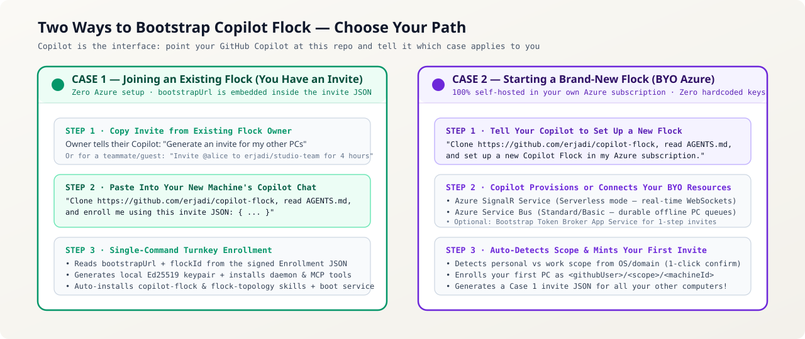

# New Copilot Flock: bring your own Azure subscription

Ask Copilot:

> "Clone https://github.com/erjadi/copilot-flock, read AGENTS.md, and set up
> a new Flock in my Azure subscription. Confirm my subscription, region,
> resource group, personal/work scope, tool installation and costs first."

Copilot executes setup; you do not need to copy credentials or type cloud
commands. Invited machines do not provision Azure. New broker-free enrollment uses a
device-bound Join Code and independently pinned Welcome Ticket; see
[the 3.4.0 protocol guide](./BROKER_FREE_V34.md).
Existing signed v3 broker invitations use the explicit
[legacy joining guide](./JOINING_AND_SHARING_GUIDE.md).

## What the managed setup provisions

One ARM deployment creates:

| Component | Default | Purpose |
| --- | --- | --- |
| Azure SignalR | Serverless, `Free_F1` | Real-time rendezvous between online machines |
| Azure Service Bus | Standard namespace, `copilot-bridge-offline` topic | Durable offline messaging |
| Child resources | Topic, `FlockSendRule` with Send only, `FlockListenRule` with Listen only | Separate owner-issued topic Send and per-peer subscription Listen SAS |

SignalR Free has connection/message quotas; Service Bus Standard incurs charges.
Review current regional pricing, quotas and subscription policy before approval.
ARM also supports `Standard_S1` for SignalR. The default has no
`Microsoft.Web` plan/site, managed identity or broker hosting.

The deploying Azure identity needs resource creation and resource/policy
key-listing permissions. The designated owner locally retains management
authority for exact subscription creation/deletion. Guests never receive it.
Explicit legacy hosting additionally needs role-assignment permission;
Contributor alone does not grant that permission.

## Copilot's execution path

The Windows entry point is `setup.ps1 -ProvisionAzure`; Debian/Ubuntu and
macOS use `setup.sh --provision-azure`. Node.js must already be installed;
prefer maintained Node 22.13+ or Node 24 for local Flock. Copilot also checks
GitHub authentication to resolve the deployment owner's label. That label does
not confer cryptographic owner authority.

1. Install Azure CLI if missing: Windows uses `winget` (possibly UAC),
   Debian/Ubuntu use the official installer (possibly `sudo`), and macOS
   requires existing Homebrew.
2. Authenticate with Azure CLI as needed; headless Linux uses device-code
   login. Select the requested subscription and resolve its actual ID.
3. Resolve the owner label from `GITHUB_USER`, otherwise authenticated
   `gh api user --jq .login`. This is the deployment's owner, not a hardcoded
   repository maintainer.
4. Create the resource group and deploy `infra/azuredeploy.json`. Names use
   the chosen prefix and a deterministic resource-group suffix.
5. Read **nonsecret metadata only** from deployment outputs. Retrieve keys
   separately through authorized Azure commands pinned to that subscription,
   resource group and resource names; validate their endpoints. Keys stay in
   process memory, not deployment outputs or installer command arguments.
6. Retrieve separate SignalR, Service Bus Manage, Send-only and Listen-only
   credentials in memory, pinned to the deployed resources and policy names.
   The default performs no ZIP deployment, Web App health polling or broker call.
7. Initialize the designated owner's persisted broker-free membership and exact
   peer subscription; locally install runtime, MCP, messaging/removal skill and
   strict boot persistence. Owner keys stay local.
8. Require persisted enrollment and connected daemon readiness before success.
   This is not a substitute for the live Azure positive/negative isolation gate.

The default has no `bootstrapUrl`. Ask the other PC's Copilot to create a
Join Code for the intended flock, independently verify its device fingerprint
at the owner, then accept the owner's sealed Welcome with an independently
verified owner fingerprint. Invitees need no Azure CLI or master connection
strings. Scope, expiry and explicitly permitted sessions are owner-approved.

### Service Bus authentication and subscription policy

The ARM template defaults `serviceBusDisableLocalAuth` to `true`. Copilot's
broker-free setup explicitly selects `false` because that transport requires
separate Manage/Send/Listen SAS policies. Before retrieving keys or starting
local installation, setup reads the selected namespace's effective
`disableLocalAuth` value and resource identity. Disabled authentication raises
`AUTH_MODE_UNSUPPORTED`; missing, denied or unprovable metadata raises
`POLICY_BLOCKED`. Key retrieval alone does not establish that SAS is usable.

If subscription policy requires local authentication to remain disabled, ask
Copilot for the **explicit hosted-broker Entra/RBAC setup** instead. It selects
`serviceBusDisableLocalAuth=true`, creates no SAS authorization rules, and uses
the broker's system-assigned identity and Service Bus Data Owner assignment.
It neither reads Service Bus keys nor installs a Service Bus connection string.
Do not bypass policy, automatically change an existing namespace, or silently
migrate a broker-free installation to hosting. Hosting requires separate
approval for B1 charges and role-assignment permissions.

### Setup selectors used by Copilot

| Windows | Bash | Default |
| --- | --- | --- |
| `-SubscriptionId` | `--subscription` | Current authenticated subscription |
| `-ResourceGroup` | `--resource-group` | `rg-copilot-flock` |
| `-Location` | `--location` | `eastus` |
| `-NamePrefix` | `--name-prefix` | `flock`, 1-20 alphanumeric characters |
| `-Scope` | `--scope` | Confirm `personal` or `work` |
| `-MachineId` | `--machine-id` | Local installer default |
| `-Flock` | `--flock` | Owner/scope flock selected by setup |
| `-LegacyBroker` | `--legacy-broker` | Off; explicit legacy hosted deployment |
| `-SkipBroker` | `--skip-broker` | Compatibility no-op; cannot combine with legacy hosting |

Advanced operators can deploy the same ARM template with reviewed parameter
overrides: `location`, `namePrefix`, `uniqueSuffix`, `signalrSku`,
`serviceBusSku` (Standard only), `serviceBusTopicName`, `serviceBusDisableLocalAuth`, `deployTokenBroker`,
`appServiceSku`, `allowedGithubRepo` and `platformMaintainerUser`. The managed
wrappers use the standard offline topic and public Azure endpoints.

## Explicit legacy hosting and existing resources

Only `-LegacyBroker` / `--legacy-broker` opts into the old hosted broker:
Linux Node 22 Web App, B1 plan, persistent storage, system-assigned identity and
namespace-scoped Service Bus role assignment. B1 incurs additional charges.
Service Bus local authentication stays disabled; its keys are not placed in Web
App settings. SignalR signing credentials remain restricted Web App settings.
This path ZIP-deploys `bootstrap-server.mjs` and `package.json`, polls `/health`
and requires confirmed broker registration/v3 enrollment. The normalized origin
is pinned; a conflicting explicit pin fails. Its one-step v3 invites do not
become broker-free Welcome Tickets. This is compatibility, not silent fallback.

Without provisioning flags, no cloud resources are created. Explicit legacy
invites/bootstrap configuration preserve the old path. Fresh broker-free owner
setup with existing resources requires SignalR and separate Service Bus
Manage/Send/Listen credentials: wrapper selectors are `ConnectionString`,
`ServiceBusConnectionString`, `ServiceBusSendConnectionString` and
`ServiceBusListenConnectionString` (or their kebab-case Bash equivalents).
Do not silently migrate an existing installation. Keep credentials out of
public artifacts and prefer managed in-memory handoff.

## Failure, security and verification

Deployment, key access or explicit legacy ZIP/health failures stop before
local installation. Azure resources already created remain in place; setup
does not automatically delete the resource group or unrelated resources.
An installer/enrollment failure can leave a local partial installation:
inspect it and repair authentication/enrollment rather than assuming success
or blindly reprovisioning. Do not publish captured deployment/app settings,
key-list responses, local configuration or GitHub tokens.

Legacy broker app settings contain resource credentials and must remain restricted to
authorized Azure operators. Removing secret outputs prevents new key
disclosure through those output fields; it does not erase historical
deployment records or rotate previously exposed keys.

Health checks establish process/configuration readiness, not provider RBAC,
offline delivery or end-to-end enrollment acceptance. The source and mock
tests do not establish live Azure deployment, pricing, all-platform support
or guaranteed latency. Network/proxy policies can still block outbound
SignalR or Service Bus connections.

Hosted Service Bus MSI requests use `https://servicebus.azure.net` by default.
`SERVICEBUS_ENTRA_RESOURCE` permits only the explicitly supported sovereign
Service Bus resource identifiers (`https://servicebus.usgovcloudapi.net` and
`https://servicebus.chinacloudapi.cn`), not arbitrary URLs or namespace hosts;
there is no fallback to
`https://servicebus.windows.net`. Token errors expose only a category/stage,
HTTP status and an AADSTS code when present, never the identity response or
token. Subscription PUT must succeed before topic POST; queue results report
`serviceBusPublished` and redacted `serviceBusCategory`, `serviceBusStage`,
`serviceBusReason`, `serviceBusStatusCode`. An accepted broker JSON queue entry
is not proof of Service Bus publication. The hosted queue's drain/ack operations
remain broker-durable-JSON mediated, not direct Entra client transport.
Every device-signed queue request's caller machine selectors must identify its
enrolled machine, including platform-maintainer devices. Foreign
body/query/header selectors are rejected. ACK mutation and `remainingCount`
are limited to that device's queue even with omitted or own selectors.
Enqueue `toMachine` targeting retains its active shared-flock authorization.
Only a non-device, GitHub-authenticated platform maintainer retains global ACK
authority.
Hosted subscription ensure first verifies an active subscription using a
bounded GET response. A missing subscription is created; a concurrent-create
409 must be followed by verified existence before publication. Canonical
`owner/flock/machineId` queue targets are authorized in that exact flock and
normalized to the enrolled bare ID. Authorized status/drain/ack operations can
heal existing canonical rows without rewriting their payload, ID or expiry.
Malformed selectors fail with 400; foreign or ambiguous enrolled targets fail
with 403. A GitHub maintainer's explicit ACK selector is scoped; only omission
of a selector retains global ACK.

After an authorized disposable setup, run the explicitly approved
[live audience/SAS isolation gate](./BROKER_FREE_V34.md#required-live-azure-gate)
before merge/release. Verify its exact-commit receipt; this guide alone does
not establish that a candidate passed.
Windows startup is at user sign-in; strict Linux installation requires
previously approved `systemd --user` lingering. Broker-free mode does not
automatically create privileged coordinators. Session sharing is explicit for
all remote callers; deployment is not permission to expose existing threads.
