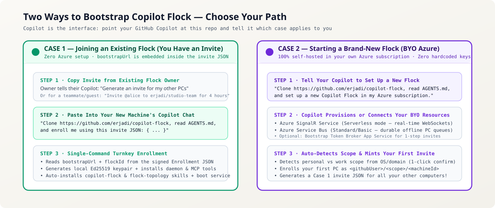

# Setting Up a Brand-New Copilot Flock Instance (Case 2: BYO Azure SignalR + Service Bus)



This guide covers **Case 2**: when you are setting up a **brand-new, independent Copilot Flock instance** for yourself or your organization using your own Azure resources (**Bring Your Own Azure SignalR + Service Bus**).

> **Joining someone else's existing flock instead?**
> If you received an invite message or signed `copilot-flock-invite-v3` JSON from a flock owner, you do **not** need to create any Azure resources! The `bootstrapUrl` is already embedded inside your invite JSON. Jump straight to **[Joining & Sharing Guide (Case 1)](./JOINING_AND_SHARING_GUIDE.md)**.

---

## Managed ARM template setup (recommended first-machine path)

Ask Copilot: *"Deploy the managed Flock ARM template in my Azure subscription
and enroll this PC. Confirm the subscription, region, resource group, scope and
charges before installing tools or creating anything."* Copilot executes the
wrapper for you; you do not need to copy connection strings or run a sequence
of cloud commands manually.

On Windows the managed entry point is `.\setup.ps1 -ProvisionAzure`
(optionally `-Scope personal -ResourceGroup rg-copilot-flock -Location eastus`).
On Debian/Ubuntu or macOS it is `./setup.sh --provision-azure`
(optionally `--scope personal --resource-group rg-copilot-flock --location eastus`).
Do not use this path for an existing invite or for the separate hubless LAN trial.

The wrappers require Node.js already installed and perform these steps:

1. Find Azure CLI; if missing, use Windows `winget` (possible UAC),
   Debian/Ubuntu's official installer (`sudo` unless already root), or macOS
   Homebrew. Missing prerequisites or unsupported automatic-install platforms
   fail explicitly instead of falling back to a different service.
2. Check `az account show`; authenticate with `az login` when needed, using
   device-code login on Linux without `DISPLAY`. Provisioning uses the CLI's
   currently selected subscription: Copilot must verify/set it before setup.
3. Create the requested resource group and deploy
   [`infra/azuredeploy.json`](../infra/azuredeploy.json). Resource names are
   deterministic for that group, using a prefix plus a unique suffix.
4. Capture the two connection-string outputs without printing them, then call
   `flock.mjs install` with both. Failures stop before local installation.

The ARM parameters are `location`, `namePrefix`, `uniqueSuffix`, `signalrSku`
(`Free_F1` or `Standard_S1`), `serviceBusSku` (`Standard` only) and
`serviceBusTopicName`. The wrappers use the template defaults; an operator can
deploy the same template with reviewed parameter overrides for an advanced
configuration. Outputs include resource names/endpoints, the topic name and
both connection strings. **These string outputs are retained in Azure deployment
history and contain resource-level keys.** Restrict deployment-history access;
never paste outputs into an issue, transcript, screenshot or public artifact.
The existing installer receives them as process arguments and persists its
protected local config, so use a trusted installation machine.

The template deploys SignalR in **Serverless** mode and Service Bus **Standard**
with the offline topic. SignalR Free has quotas; Service Bus Standard is paid.
Subscription/RBAC permissions, provider registration, policy, existing resource
names and regional quotas can cause a deployment failure. The wrappers do not
delete a resource group or roll back unrelated resources on failure.

**The Token Broker is not part of this initial template.** Continue with the
broker deployment recipe below to unlock signed one-step enrollment for
additional PCs, collaborators and guests; direct connection-string installation
is not that broker-backed onboarding journey. The ARM structure and wrapper
flows have local syntax/unit/mock coverage; a real Azure deployment still
requires an authorized subscription and has not been validated by those mocks.

---

## Who Is This Guide For?

| User Type | Recommended Approach | Time Required |
| :--- | :--- | :--- |
| **Everyday Copilot User** | **Managed ARM Setup / Option A**: Copilot runs the opt-in setup wrapper to provision both services and enroll your PC. | Depends on CLI installation, sign-in and Azure deployment |
| **Cloud / DevOps Engineer** | **Option B — Reviewed `az` Provisioning + Token Broker**: Deploy the base resources declaratively or with the recipes below, then host the broker for signed invites and guest passes. | Base deployment plus separately configured broker hosting |
| **Direct / Personal-Only Setup** | **Option C — Existing Connection Strings (No Token Broker)**: Copilot installs with approved existing credentials. | No new-resource deployment; local installation still required |

---

## Why Does a New Flock Use Azure SignalR + Service Bus?

`copilot-flock` contains **zero vendor-hosted cloud servers and zero hardcoded credentials**. When you create a new flock, your machines communicate through two lightweight resources in your own Azure subscription:

1. **Azure SignalR Service (`Serverless` mode)** — Provides real-time, sub-50ms WebSocket routing (`wss://<your-signalr>.service.signalr.net/client/?hub=copilotbridge`) between online machines across LANs, VPNs, and NATs over outbound `TCP 443` without opening any inbound firewall ports.
   - *Cost*: Works on the **Free (`Free_F1`)** tier (up to 20 concurrent connections / 20,000 messages per day) or **Standard (`Standard_S1`)**.
2. **Azure Service Bus Namespace (`Standard` SKU + topic `copilot-bridge-offline`)** — Provides durable, at-least-once **offline message queueing** using a Service Bus topic (`copilot-bridge-offline`) and per-machine subscriptions. *(Note: Use `Standard` SKU because Service Bus topics/subscriptions require `Standard`, not `Basic`.)* When your laptop is asleep or powered off, messages and release updates wait safely in Service Bus and drain automatically the moment it wakes up.
3. **Optional: Bootstrap Token Broker (`bootstrap-server.mjs`)** — A tiny, zero-dependency Node.js HTTP service (runs on a Basic/Standard Azure App Service, Container App, or VM) that verifies Ed25519 signatures and GitHub identities to mint short-lived 60-minute hub JWTs for **1-step pasteable invites**, **collaborator flocks (`<owner>/<team>`)**, and **time-bound guest passes**.

---

## Option A — Let Your Copilot Set Everything Up (Recommended)

Open GitHub Copilot Desktop (or GitHub Copilot CLI) on your first computer and say:

> *"Clone `https://github.com/erjadi/copilot-flock`, read `AGENTS.md`, and set up a brand-new Copilot Flock instance in my Azure subscription."*

### What Your Copilot Will Do Automatically:
1. Check that you are signed into Azure CLI (`az account show`) and GitHub CLI (`gh auth status`), prompting you to sign in if needed.
2. Auto-detect whether this computer is a **`personal`** or **`work`** machine from OS/domain signals and ask you to confirm with 1 click (or use `--scope personal|work` in non-interactive CLI mode).
3. Use the managed setup wrapper to create a resource group (e.g. `rg-copilot-flock`) and deploy `infra/azuredeploy.json`: **SignalR Serverless** plus **Service Bus Standard** and the offline topic.
4. Enroll your first machine (`<your-github-handle>/<scope>/<HOSTNAME>`), start the background daemon, register the `copilot-flock` MCP server, and install both the `copilot-flock` and `flock-topology` skills.
5. Optionally deploy `bootstrap-server.mjs` and generate a **Case 1 Invite JSON** that you can paste into your other computers!

---

## Option B — Step-by-Step Azure CLI Provisioning (With Token Broker for Invites)

Below are complete, copy-pasteable recipes for both **PowerShell (Windows)** and **Bash (Linux / macOS)**.

### 1. Provision Azure SignalR (`Serverless`) + Service Bus (`Standard` + Topic)

#### PowerShell (Windows)

No fork is required: clone `erjadi/copilot-flock` and configure your broker with
`ALLOWED_GITHUB_REPO="erjadi/copilot-flock"` and
`PLATFORM_MAINTAINER_USER="<your-github-login>"` (default: `erjadi`).
The broker authenticates GitHub `/user` and grants credential/management access
to that deployment maintainer, repository owners/write/maintainer/admin
collaborators, or an explicit `ALLOWED_GITHUB_USERS` allowlist. Maintainer and
allowlist access do not depend on repository write access or even repository
existence. The allowlist is comma-separated, case-insensitive and trimmed;
leave it unset unless deliberately granting deployed-instance credential access.

Authenticated teammates/guests can redeem recipient-bound, broker-stored v3
invite vouchers on `/api/v3/enroll` without repository write access. Their device
must sign the enrollment request; the full-Flock clients do this automatically.
The current broker checks the stored voucher, recipient, scope, capacity and
expiry; it does **not** verify the optional `voucherSignature` field as an
Ed25519 voucher signature. Device enrollment signatures are verified separately.
Invite-free enrollment remains privileged. Guests cannot substitute another
GitHub identity, and `/api/v3/my-flocks` exposes only their own memberships.
These paths never grant legacy bootstrap connection strings or management access.

```powershell
$RG       = "rg-copilot-flock"
$LOCATION = "eastus"
$SUFFIX   = -join ((48..57) + (97..122) | Get-Random -Count 6 | ForEach-Object {[char]$_})
$SIGNALR  = "flock-signalr-$SUFFIX"
$SB_NS    = "flock-sb-$SUFFIX"
$SB_TOPIC = "copilot-bridge-offline"

az group create --name $RG --location $LOCATION

az signalr create `
  --name $SIGNALR `
  --resource-group $RG `
  --location $LOCATION `
  --sku Free_F1 `
  --unit-count 1 `
  --service-mode Serverless

az servicebus namespace create `
  --name $SB_NS `
  --resource-group $RG `
  --location $LOCATION `
  --sku Standard

az servicebus topic create `
  --resource-group $RG `
  --namespace-name $SB_NS `
  --name $SB_TOPIC

$SIGNALR_CONN = az signalr key list --name $SIGNALR --resource-group $RG --query primaryConnectionString -o tsv
$SB_CONN      = az servicebus namespace authorization-rule keys list --resource-group $RG --namespace-name $SB_NS --name RootManageSharedAccessKey --query primaryConnectionString -o tsv
```

#### Bash (Linux / macOS)
```bash
RG="rg-copilot-flock"
LOCATION="eastus"
SUFFIX="$(LC_ALL=C tr -dc 'a-z0-9' </dev/urandom | head -c 6)"
SIGNALR="flock-signalr-$SUFFIX"
SB_NS="flock-sb-$SUFFIX"
SB_TOPIC="copilot-bridge-offline"

az group create --name "$RG" --location "$LOCATION"

az signalr create \
  --name "$SIGNALR" \
  --resource-group "$RG" \
  --location "$LOCATION" \
  --sku Free_F1 \
  --unit-count 1 \
  --service-mode Serverless

az servicebus namespace create \
  --name "$SB_NS" \
  --resource-group "$RG" \
  --location "$LOCATION" \
  --sku Standard

az servicebus topic create \
  --resource-group "$RG" \
  --namespace-name "$SB_NS" \
  --name "$SB_TOPIC"

SIGNALR_CONN="$(az signalr key list --name "$SIGNALR" --resource-group "$RG" --query primaryConnectionString -o tsv)"
SB_CONN="$(az servicebus namespace authorization-rule keys list --resource-group "$RG" --namespace-name "$SB_NS" --name RootManageSharedAccessKey --query primaryConnectionString -o tsv)"
```

### 2. Optional: Deploy `bootstrap-server.mjs` (For 1-Step Pasteable Invites & Multi-Flock Guest Passes)

If you want to enroll additional PCs or invite teammates using 1-step signed Enrollment JSONs (without copying Azure connection strings to every machine), deploy `bootstrap-server.mjs` to an Azure Web App with Managed Identity access to your Service Bus namespace:

#### PowerShell (Windows)
```powershell
$PLAN    = "flock-bootstrap-plan-$SUFFIX"
$WEBAPP  = "flock-bootstrap-$SUFFIX"
$GH_USER = (gh api user --jq .login)

az appservice plan create --name $PLAN --resource-group $RG --location $LOCATION --sku B1 --is-linux
az webapp create --name $WEBAPP --resource-group $RG --plan $PLAN --runtime "NODE:22-lts"

# Grant the Web App Managed Identity permission to publish/manage Service Bus offline subscriptions
$PRINCIPAL_ID = az webapp identity assign --name $WEBAPP --resource-group $RG --query principalId -o tsv
$SB_ID        = az servicebus namespace show --name $SB_NS --resource-group $RG --query id -o tsv
az role assignment create --assignee $PRINCIPAL_ID --role "Azure Service Bus Data Owner" --scope $SB_ID

# Configure environment variables (matching bootstrap-server.mjs) and startup command
az webapp config appsettings set --name $WEBAPP --resource-group $RG --settings `
  SIGNALR_CONNECTION_STRING="$SIGNALR_CONN" `
  SERVICEBUS_NAMESPACE="$SB_NS.servicebus.windows.net" `
  SERVICEBUS_TOPIC="$SB_TOPIC" `
  ALLOWED_GITHUB_REPO="erjadi/copilot-flock" `
  PLATFORM_MAINTAINER_USER="$GH_USER" `
  COPILOT_FLOCK_HUB="copilotbridge"

az webapp config set --name $WEBAPP --resource-group $RG --startup-file "node bootstrap-server.mjs"

# Package and deploy bootstrap-server.mjs + package.json, then verify /health
Compress-Archive -Path bootstrap-server.mjs, package.json -DestinationPath bootstrap-deploy.zip -Force
az webapp deploy --resource-group $RG --name $WEBAPP --src-path bootstrap-deploy.zip --type zip
Invoke-RestMethod "https://$WEBAPP.azurewebsites.net/health"
```

#### Bash (Linux / macOS)
```bash
PLAN="flock-bootstrap-plan-$SUFFIX"
WEBAPP="flock-bootstrap-$SUFFIX"
GH_USER="$(gh api user --jq .login)"

az appservice plan create --name "$PLAN" --resource-group "$RG" --location "$LOCATION" --sku B1 --is-linux
az webapp create --name "$WEBAPP" --resource-group "$RG" --plan "$PLAN" --runtime "NODE:22-lts"

PRINCIPAL_ID="$(az webapp identity assign --name "$WEBAPP" --resource-group "$RG" --query principalId -o tsv)"
SB_ID="$(az servicebus namespace show --name "$SB_NS" --resource-group "$RG" --query id -o tsv)"
az role assignment create --assignee "$PRINCIPAL_ID" --role "Azure Service Bus Data Owner" --scope "$SB_ID"

az webapp config appsettings set --name "$WEBAPP" --resource-group "$RG" --settings \
  SIGNALR_CONNECTION_STRING="$SIGNALR_CONN" \
  SERVICEBUS_NAMESPACE="$SB_NS.servicebus.windows.net" \
  SERVICEBUS_TOPIC="$SB_TOPIC" \
  ALLOWED_GITHUB_REPO="erjadi/copilot-flock" \
  PLATFORM_MAINTAINER_USER="$GH_USER" \
  COPILOT_FLOCK_HUB="copilotbridge"

az webapp config set --name "$WEBAPP" --resource-group "$RG" --startup-file "node bootstrap-server.mjs"

zip -q bootstrap-deploy.zip bootstrap-server.mjs package.json
az webapp deploy --resource-group "$RG" --name "$WEBAPP" --src-path bootstrap-deploy.zip --type zip
curl -fsSL "https://$WEBAPP.azurewebsites.net/health"
```

### 3. Enroll Your First Machine

```powershell
# PowerShell (Windows)
node flock.mjs install `
  --scope personal `
  --bootstrap-url "https://$WEBAPP.azurewebsites.net/api/bootstrap" `
  --connection-string "$SIGNALR_CONN" `
  --servicebus-connection-string "$SB_CONN"
```

```bash
# Bash (Linux / macOS)
node ./flock.mjs install \
  --scope personal \
  --bootstrap-url "https://$WEBAPP.azurewebsites.net/api/bootstrap" \
  --connection-string "$SIGNALR_CONN" \
  --servicebus-connection-string "$SB_CONN"
```

---

## Platform, Boot Persistence & Network Notes

- **Node.js Requirement**: Requires **Node.js `>= 22.5`** (uses built-in `node:sqlite` with zero native npm addons; Node 18/20 is supported if the `sqlite3` CLI binary is installed on `PATH`).
- **Headless Linux Boot Persistence (`systemd --user`)**:
  - `node flock.mjs install` writes and enables `~/.config/systemd/user/copilot-flock.service`.
  - On headless Linux servers (`Ubuntu` / `Debian` / `Jetson`) where no user logs into a desktop session after reboot, enable systemd user lingering once so the daemon starts automatically on boot and stays alive after SSH logout:
    ```bash
    sudo loginctl enable-linger "$USER"
    systemctl --user status copilot-flock.service
    ```
- **Windows Boot Persistence (`copilot-flock.vbs`)**:
  - `node flock.mjs install` places `copilot-flock.vbs` in `%APPDATA%\Microsoft\Windows\Start Menu\Programs\Startup`, which launches the daemon at user sign-in. On unattended Windows cloud VMs, keep an active user session or configure a Windows Scheduled Task (`ONSTART`).
- **Outbound Network & VPN Resilience**:
  - Requires only **outbound TCP `443` (HTTPS / WSS)** to `*.service.signalr.net`, `*.servicebus.windows.net`, and `api.github.com`.
  - Includes a built-in IPv4-first DNS resolver (`ipv4Lookup` + `dns.resolve4` fallback cache) that prevents disconnected OpenVPN/NordVPN IPv6 adapters from blackholing SignalR reconnects.

Once your first machine is enrolled, simply tell your Copilot:
> *"Generate an invite for my other personal and work PCs"*

Your Copilot will call `invite_to_flock` and hand you a **Case 1 Invite JSON** containing your `bootstrapUrl`—so every subsequent machine you add requires **zero Azure CLI setup**!

---

## Option C — Direct Connection Strings (Zero Web App / Personal-Only Setup)

If you only want to connect your own computers and prefer not to run a Bootstrap App Service at all, pass your SignalR and Service Bus connection strings directly on each machine:

```powershell
node flock.mjs install `
  --scope personal `
  --connection-string "$SIGNALR_CONN" `
  --servicebus-connection-string "$SB_CONN"
```

All local config is stored at `~/.copilot/flock/config.json` with strict owner-only file permissions (`0600` on Linux/macOS).

---

## Verifying Your New Flock Instance

Ask your Copilot in plain English:
- *"Check flock status and diagnose the flock"* -> Runs `diagnose_bridge_fleet` and confirms the background daemon, MCP server, `Copilot Flock Coordinator`, `Copilot Flock Thread Tracker`, and boot persistence are healthy.
- *"Show me a flock topology diagram in light mode"* -> Uses the bundled `flock-topology` skill to render your live `flowchart LR` Mermaid graph, Markdown Overlap Matrix, and Warm-Alabaster SVG topology map.
