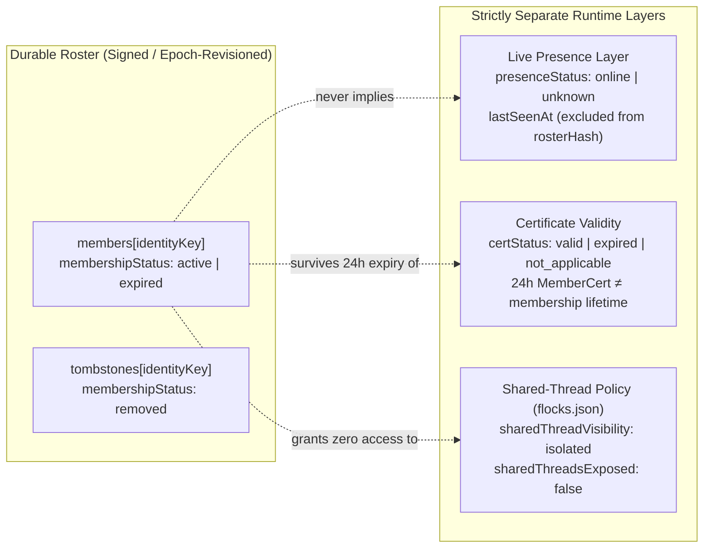

# Flock Membership Registry Without Live Peer Pings

`copilot-flock` maintains a durable, revisioned per-flock membership registry (`~/.copilot/flock/flock-registry.json`, implemented in [`flock-registry.mjs`](../flock-registry.mjs)) so any enrolled machine can inspect all authorized flock members—online or offline, owner, collaborator, or guest—without broadcasting live `ping` RPCs across the flock.

---

## 1. Copilot-First Usage

Ask GitHub Copilot naturally:

- *"Who are all the enrolled members of `erjadi/studio-team`, including offline laptops?"*
- *"Show the cached membership roster and any removed member tombstones for my flocks without pinging machines."*
- *"Sync the latest signed membership roster from the flock owner for `erjadi/studio-team`."*

Under the hood, Copilot invokes the `list_flock_members` MCP tool (or `list_flocks`) against the local durable registry in under a millisecond with zero peer-to-peer pings.

| Operation | MCP Tool | Behavior |
| --- | --- | --- |
| Read durable roster | `list_flock_members` (`flock`, `include_removed`) | Pure local read from `flock-registry.json`; zero network traffic or live pings. |
| Reconcile legacy v3 broker | `list_flock_members` (`refresh_broker: true`) | Reconciles `/api/v3/my-flocks` + `/api/members` over HTTPS without pinging peers. |
| Sync broker-free v3.4 owner | `list_flock_members` (`flock`, `sync_owner: true`) | Fetches the latest owner-signed snapshot from the designated owner only (`roster_sync`). |

---

## 2. Core Invariants & Security Boundaries

### 2.1 Cryptographic Identity Indexing (Never Hostname Alone)
Every per-flock record in `flocks[<flockId>]` indexes `members`, `tombstones`, and `presence` by cryptographic member/device identity (`identityKey` derived from `peerId` and Ed25519 `keyFingerprint`), **never by `machineId` / hostname alone**:

- **Broker-free v3.4 (`protocol: "broker-free-v34"`)**: `peerId` and `keyFingerprint` are the 64-hex SHA-256 digest of the device's SPKI DER Ed25519 public key (`ownerFingerprint(deviceEd25519Pub)`). Any record missing a matching Ed25519 public key or 64-hex fingerprint is rejected (`ROSTER_IDENTITY_REQUIRED` / `ROSTER_KEY_MISMATCH`).
- **Legacy broker-backed v3 (`protocol: "v3-broker"`)**: Indexed by authenticated `(peerId, keyFingerprint)` from `/api/v3/my-flocks` and `/api/v3/enroll`. Two collaborators whose machines share the same hostname (for example `WORK-LAPTOP`) remain distinct entries; kicking one device tombstones only that cryptographic identity. Candidate records containing only `machineId` are rejected (`ROSTER_IDENTITY_REQUIRED`).

### 2.2 Revisioned Removal Tombstones & Anti-Rollback Protection
Each flock maintains a monotonically advancing `(rosterEpoch, rosterRevision)` pair and a canonical SHA-256 `rosterHash` computed over `{ flockId, protocol, rosterEpoch, rosterRevision, members, tombstones }`:

1. **Rollback & Conflict Rejection**:
   - Snapshots, deltas, broker responses, or cache merges with `(epoch, revision) < (stored.rosterEpoch, stored.rosterRevision)` (or `epoch < minAcceptedEpoch`) fail closed with `ROSTER_ROLLBACK_REJECTED`.
   - Payloads at the exact same `(epoch, revision)` with a differing `rosterHash` fail closed with `ROSTER_HASH_CONFLICT`.
2. **Tombstone Anti-Resurrection**:
   - Removing a member records a durable tombstone (`removedAtEpoch`, `removedAtRevision`, `removedAtMs`, `reason`, `operationId`) in `flocks[<flockId>].tombstones[<identityKey>]`.
   - Merging an older cache (`mergeRegistryCache`) or replaying a stale/crafted snapshot cannot resurrect a tombstoned identity or strip retained tombstones (`ROSTER_RESURRECTION_REJECTED` / `ROSTER_TOMBSTONE_OMITTED`).
3. **Cross-Flock Isolation**:
   - Every flock (`erjadi/personal`, `erjadi/work`, `erjadi/studio-team`) has an isolated namespace in `flock-registry.json`. Snapshots and deltas carry a signed `flockId` claim; applying an artifact signed for another flock is rejected (`ROSTER_FLOCK_MISMATCH`).

### 2.3 Strict Separation of Membership, Presence, Certificates, and Shared Threads
Cached membership authorization is structurally isolated from ephemeral runtime state:

- **Live Presence (`presenceStatus: "online" | "unknown"`, `lastSeenAt`)**: Stored outside `rosterHash`. Without a verified live SignalR observation within `presenceTtlMs` (default 60s), `presenceStatus` is `"unknown"`—even immediately after reconciling `/api/members` registration timestamps—so cached membership is never mistaken for live reachability, and offline collaborators remain `"active"` members with `"unknown"` presence.
- **Certificate Validity (`certStatus: "valid" | "expired" | "not_applicable"`)**: Evaluated at read time against `certIssuedAtMs` and `certExpiresAtMs`. When a broker-free collaborator's short-lived 24h `MemberCert` expires over a weekend while their 30-day `membershipExpiresAtMs` remains valid, `certStatus` becomes `"expired"` while `membershipStatus` stays `"active"`.
- **Shared-Thread Visibility (`sharedThreadVisibility: "isolated"`, `sharedThreadsExposed: false`)**: Presence in `flock-registry.json` never exposes local Copilot sessions or transcripts. Thread sharing remains governed exclusively by local `flocks.json` `sharedSessionIds` / `sharedSnapshots` and signed `MemberCert.sessionIds`.

---

## 3. Protocol Flows

### 3.1 Legacy Broker-Backed v3 (`/api/v3/my-flocks` + `/api/members`)
1. **Enrollment & Discovery**: `applyV3EnrollmentResult` and `list_flocks` / `list_flock_members(refresh_broker: true)` reconcile per-flock authorization records from `GET /api/v3/my-flocks` (`rosterEpoch`, `peerId`, `keyFingerprint`, `publicKey`, `trustTier`, `membershipExpiresAt`).
2. **Hardware Metadata Enrichment**: Optional host records from `GET /api/members` enrich non-authoritative display fields (`specs`, `version`, `platform`, `githubName`) only when cryptographic `keyFingerprint` / `publicKey` aligns (or unambiguous `(githubUser, machineId)` when no conflicting key exists). `/api/members` `lastSeenAt` is recorded with `liveVerified: false` so `presenceStatus` remains `"unknown"` until a live SignalR frame is observed.
3. **Epoch Advancement & Kicks**: When `kick_flock_member` succeeds or `/api/v3/my-flocks` returns a higher `rosterEpoch` omitting a previously cached member, the registry removes the member from `members` and writes a revisioned tombstone at `removedAtEpoch`.

### 3.2 Broker-Free v3.4 (Owner-Signed Snapshots & Deltas)
1. **Owner Authority**: Only the pinned flock rotation owner (`ownerFingerprint(ownerPublicKey)`) can sign `copilot-flock/3.4/control/roster-snapshot` and `copilot-flock/3.4/control/roster-delta` control artifacts.
2. **Join Bootstrap (Welcome Ticket)**: During `approve_join`, the owner increments `rosterRevision`, signs the updated `roster-snapshot`, embeds it inside the X25519-sealed Welcome Ticket `metadata.rosterSnapshot`, and publishes a signed `roster-update` delta over Service Bus + SignalR when other peers are already enrolled. Accepting the Welcome Ticket immediately populates the new device's `flock-registry.json`—including offline collaborators—with zero peer pings.
3. **Removal & Epoch Rotation**: During `removePeer` (kick or signed device leave), the owner increments both `epoch` and `rosterRevision`, records the removed `peerId` tombstone, and attaches `rosterDelta` and `rosterSnapshot` alongside the signed `rotation` message so retained peers atomically rotate their group key and record the removal tombstone.
4. **Missed Delta Detection & Recovery (`ROSTER_DELTA_GAP`)**: Every `roster-delta` binds `(baseEpoch, baseRevision, baseRosterHash)`. If an offline peer missed an intermediate delta, `applySignedDelta` rejects the out-of-sequence delta with `ROSTER_DELTA_GAP` and persists `needsSnapshotSync = true`. Calling `syncRoster(flockId)` (`list_flock_members` with `sync_owner: true`, or receiving the next `rotation` carrying `rosterSnapshot`) fetches and verifies the latest owner-signed full snapshot from the designated owner without pinging any other member.
