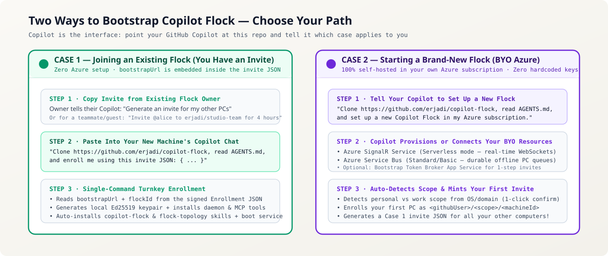
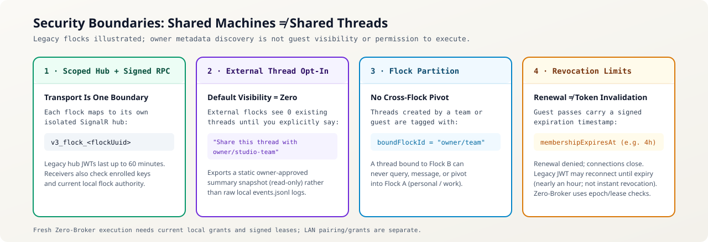

# Joining an Existing Flock, Inviting Teammates & Sharing Threads (Case 1 Guide)



This guide covers **Case 1**: joining an **existing Copilot Flock** via a pasteable invite, adding your own additional computers, creating shared collaborator flocks (`<owner>/<team>`), issuing time-bound guest passes (`<owner>/<flock>/<machineId>`), and sharing specific threads safely.

---

## 1. How Case 1 Works: Why Invitees Need Zero Azure Setup

When a flock owner generates an invite, their Copilot produces a **1-step copy-pasteable message** containing an Ed25519-signed **`copilot-flock-invite-v3` Enrollment JSON**:

```json
{
  "type": "copilot-flock-invite-v3",
  "version": "3.0.0",
  "voucherId": "00000000-0000-4000-8000-000000000013",
  "flockId": "erjadi/studio-team",
  "flockType": "collaborator",
  "ownerUser": "erjadi",
  "invitedGithubUser": "alice",
  "trustTier": "collaborator",
  "maxDevices": 3,
  "membershipExpiresAt": "2026-11-08T14:00:00.000Z",
  "bootstrapUrl": "https://<owner-bootstrap-host>/api/bootstrap",
  "issuedAt": "2026-11-08T10:00:00.000Z",
  "voucherExpiresAt": "2026-11-09T10:00:00.000Z",
  "ownerSignature": "base64url-ed25519-signature"
}
```

Notice that **`bootstrapUrl` is embedded directly inside the signed JSON**:
- The recipient **never** needs an Azure subscription, Azure CLI login, or connection string.
- Even if the recipient hasn't installed `copilot-flock` yet, they simply paste the invite message into their GitHub Copilot chat.
- Their Copilot clones `https://github.com/erjadi/copilot-flock`, reads `AGENTS.md`, generates a local Ed25519 keypair (`~/.copilot/flock/keys/`), presents the signed voucher + their GitHub identity to `bootstrapUrl` (`/api/v3/enroll`), and receives a scoped 60-minute hub token!

---

## 2. Step-by-Step: Joining a Flock When You Receive an Invite

Whether you are the **flock owner adding your 2nd PC**, a **teammate joining a shared team flock**, or a **guest given a 4-hour pass to a GPU workstation**, the step is identical:

1. Open **GitHub Copilot Desktop** (or **GitHub Copilot CLI** on a headless Linux server).
2. Paste the invite message you received (or tell your Copilot):
   > *"Clone `https://github.com/erjadi/copilot-flock`, read `AGENTS.md`, and enroll me using this invite JSON: `<paste JSON>`"*
3. **Done!** In ~5 seconds, your Copilot:
   - Installs `~/.copilot/flock/flock.mjs` and configures OS boot persistence (Windows Startup `.vbs` or Linux `systemd --user` `copilot-flock.service`).
   - Enrolls your machine into the target flock (`<owner>/<flock>`) and saves `bootstrapUrl` in `~/.copilot/flock/config.json`.
   - Registers the `copilot-flock` MCP server and installs the `copilot-flock` + `flock-topology` skills.

---

## 3. Universal Hierarchical Addressing (`<owner>/<flock>[/<machineId>]`)

Every flock and machine in `copilot-flock` follows one consistent, human-readable address grammar—just like GitHub repositories:

| Address Pattern | Example | Meaning | Default Thread Visibility |
| :--- | :--- | :--- | :--- |
| **`<owner>`** | `erjadi` | **Owner Root Flock** — All machines owned by `@erjadi` (`personal` + `work`). | All owner threads across all `@erjadi` PCs |
| **`<owner>/personal`** | `erjadi/personal` | **Personal Scope Flock** — `@erjadi`'s personal desktops, laptops, and home lab nodes (`LINUX-GPU-HOST`, `LINUX-CONSOLE`). | All owner threads on `personal` PCs |
| **`<owner>/work`** | `erjadi/work` | **Work Scope Flock** — `@erjadi`'s corporate/work laptops and cloud VMs (`ARM64-LAPTOP`, `CLOUD-DEV-VM`). | All owner threads on `work` PCs |
| **`<owner>/<team>`** | `erjadi/studio-team` | **Collaborator Team Flock** — A named shared flock where invited `@githubUser` teammates can collaborate across specific machines. | **Explicit opt-in only** (`0` existing threads exposed by default) |
| **`<owner>/<flock>/<machineId>`** | `erjadi/work/CLOUD-DEV-VM` | **Single-Machine Address / Guest Pass** — Targets a single PC (or grants time-bound guest access to just that PC). | **Explicit opt-in only** (`0` existing threads exposed by default) |

> **Note on Scope Naming**: Only **`personal`** and **`work`** are used for owner scopes (`private` is retired and automatically migrated to `personal`).

---

## 4. Generating Invites (What to Say to Your Copilot)

As a flock owner, you never have to construct JSON or run CLI flags manually—just ask your Copilot in plain English:

### A. Enroll Another One of Your Own Computers
> *"Generate an invite so I can add my new Linux desktop to `erjadi/personal`."*

The broker verifies the recipient's GitHub identity. An owner redeeming their own
invite retains owner access to their built-in root and scope flocks, even when
the voucher says `collaborator` or `guest`. Vouchers cannot grant owner trust to
another user or to a shared team flock. Repeated flock records are applied once;
cached permissions and caller-supplied identity labels never establish ownership.
Rejected enrollment is reported as incomplete even if legacy local installation
can still finish.

### B. Invite a Teammate to a Shared Team Flock (Up to 3 PCs Automatically)
> *"Invite `@alice` to `erjadi/studio-team` so she can connect her work laptop and desktop."*
- By default, collaborator vouchers include `maxDevices: 3`, so `@alice` can enroll up to 3 of her machines using the same pasteable JSON within 24 hours.

### C. Issue a Time-Bound Guest Pass to One Specific Machine (or Flock)
> *"Give `@bob` a 4-hour guest pass to `erjadi/personal/LINUX-GPU-HOST` so his Copilot can inspect our shared calibration thread and check GPU status."*
- Sets `durationMinutes: 240` (`membershipExpiresAt`).
- Across different GitHub users (`trustTier: "guest"` or `"collaborator"`), access is strictly informational / scoped to `boundFlockId` and explicitly shared threads (`FLOCK_MUTATION_FORBIDDEN` blocks `self_update` or unapproved host mutations; `autopilot` + `allow-all` Coordinator/Thread Tracker execution is strictly limited to same-owner `owner_root` / `owner_scope` flocks).
- When the 4 hours expire (or you revoke access early), the Bootstrap Broker refuses new token refreshes and evicts active WebSocket connections going forward.

---

## 5. Security & Privacy: The 4 Anti-Leakage Hard Walls



A core rule of `copilot-flock` is: **Shared machines ≠ shared threads.**
Enrolling `CLOUD-DEV-VM` or `LINUX-GPU-HOST` into `erjadi/studio-team` never exposes your personal or work chats on that machine.

### How Thread Sharing Works in Practice:
- **Share a curated snapshot of the current thread with a team flock**:
  > *"Share this thread with `erjadi/studio-team`."* (Calls MCP tool `share_thread`, exporting a static, read-only `approved-snapshot` summary rather than raw `events.jsonl` tool logs. Always review the summary text to ensure no sensitive strings are included.)
- **Collaborate in an isolated team thread (`boundFlockId`)**:
  > Collaborators in `erjadi/studio-team` can interact with sessions explicitly created for `boundFlockId = "erjadi/studio-team"` without ever listing, reading, or pivoting into your `personal` or `work` threads.
- **Audit what you are sharing right now**:
  > *"What threads am I sharing right now?"* (Calls MCP tool `list_shared_threads` and lists every opted-in thread and which flock can see it.)
- **Stop sharing a thread immediately**:
  > *"Unshare this thread from `erjadi/studio-team`."* (Calls MCP tool `unshare_thread`, revoking external visibility immediately.)
- **Kick a member or revoke a guest pass early**:
  > *"Remove `@bob` from `erjadi/personal/LINUX-GPU-HOST`."* (Calls MCP tool `kick_flock_member`, increments `rosterEpoch`, and drops active WebSocket connections immediately.)
